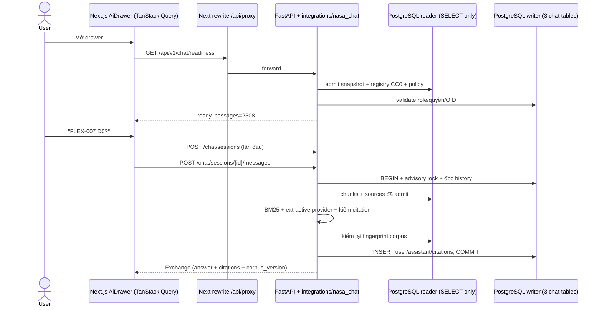

# Chatbot NASA (RAG extractive): luồng hoạt động và cách chạy

Cập nhật 2026-11-14. Kiến trúc mang từ repo tham chiếu `NASA` sang repo này. Phiên bản bộ
trả lời là `nasa-extractive-v2`, phiên bản chính sách nguồn là `nasa-extractive-v1`.

Chatbot trả lời bằng **trích đoạn nguyên văn** từ nguồn NASA PSI đã nhập. Mỗi trích đoạn
có citation và gắn với một phiên bản corpus cụ thể. Không dùng LLM, provider trả phí hay
câu trả lời mẫu. `origin=real` nghĩa là nguồn thật. `review_status` luôn là `unreviewed`
vì chưa có thẩm định khoa học độc lập. Chatbot không đưa kết luận safe/unsafe.

## Theo thao tác người dùng

1. **Mở AI Drawer.** FE gọi `GET /chat/readiness`. Khi chưa `ready`, nút Send bị khóa và
   có nút "Retry connection".
2. **Gửi câu hỏi.** Nếu tab chưa có session, FE tạo session (`POST /chat/sessions`) rồi
   gửi câu hỏi. Session ID chỉ lưu trong `sessionStorage` của tab đó.
3. **Server truy xuất.** Server đọc chunk của các nguồn CC0 đã nhập rồi xác định đúng
   study/run được hỏi:
   - Từ tiếng Việt được mở rộng bằng alias (ví dụ "đường kính" → diameter/d0).
   - Các đoạn liên quan được xếp hạng bằng BM25.
4. **Provider tạo câu trả lời.** Câu trả lời gồm tối đa 4 trích đoạn nguyên văn. Với các
   số liệu mâu thuẫn, provider giữ cả hai; ví dụ D0 của FLEX-007 là 1.87 mm theo CSV và
   1.82 mm theo TestSheet. Provider từ chối theo quy tắc trong các trường hợp:
   - câu hỏi đòi kết luận an toàn,
   - câu hỏi ngoài phạm vi,
   - câu hỏi về trọng lực Mặt Trăng/Sao Hỏa,
   - câu hỏi trộn nhiều run.
5. **Server kiểm lại và lưu.** Server so lại provider output, fingerprint corpus và
   registry nguồn. Sau đó user + assistant + citations được lưu trong **một transaction**,
   dưới advisory lock theo session. Nếu có lỗi hoặc dữ liệu đổi giữa chừng thì không lưu
   nửa cặp (409 hoặc 502).
6. **FE hiển thị.** "View source n" gọi `GET /chat/sources/{id}?locator=…&corpus_version=…`
   để mở file NASA gốc (link https, license, SHA-256). Citation thuộc corpus cũ trả 409;
   khi đó trích đoạn gốc trong tin nhắn vẫn giữ nguyên.



## Các lớp code

| Lớp | File | Trách nhiệm |
| --- | --- | --- |
| UI | `FlameInFreewall_Tourbillion/src/components/ai/{AiDrawer,AiMessageItem,CitationBadge}.tsx` | Readiness gate, gửi câu hỏi, khôi phục history, trạng thái answered/abstained/timeout, citations |
| Hooks | `src/hooks/api/useChatQueries.ts` | Query readiness/history/source; mutation tạo session + gửi (thử lại 1 lần khi session hết hạn) |
| Client | `src/api/services/chatService.ts`, `src/api/dto/chat.ts`, `src/api/mappers/chatMapper.ts` | Đúng contract BE (chat lõi snake_case, readiness/sources camelCase); timeout gửi 30 s |
| Token | `src/lib/chatSession.ts` | Session ID trong `sessionStorage`, chỉ nhận UUID |
| App integration | `integrations/nasa_chat/app.py` | `create_app()` gọi factory BE gốc, `dependency_overrides` cho chat; thêm `/chat/readiness`, `/chat/sources/{id}` |
| Service | `integrations/nasa_chat/service.py` | Admission corpus, history, lock, kiểm provider, ghi atomic |
| Retrieval | `integrations/nasa_chat/retrieval.py`, `bm25.py` | Chuẩn hóa, alias VI/EN, anchor study/run, BM25, cắt trích đoạn |
| Provider | `integrations/nasa_chat/provider.py` | Ghép trích đoạn hoặc abstain; không tự tạo số liệu |
| Policy | `integrations/nasa_chat/policy.py` | Registry CC0/hash/revision, policy version |
| Data | `integrations/nasa_data/` | Build release NASA offline (mặc định `unified`, chỉ nguồn chính thức), xuất snapshot 21 bảng/slugs/artifacts. Xem `docs/DATA_HANDOFF.md` |
| BE nền | `flameguard-ai-backend/` | **Không sửa.** DTO chat, TTL session, repository, validator role runtime |

## Giới hạn và đảm bảo

- **Phạm vi nguồn:** chỉ nguồn CC0-1.0 có trong registry. Nguồn unknown-rights bị loại.
  Mỗi chunk gắn source/locator/hash và được đối chiếu với DB trước khi dùng.
- **Ý nghĩa điểm số:** BM25 là độ liên quan, không phải xác suất đúng hay xác suất rủi ro.
- **Giới hạn kích thước:**

  | Đối tượng | Giới hạn |
  | --- | --- |
  | Câu hỏi | ≤ 4000 ký tự |
  | History gửi cho provider | ≤ 12 tin / 12000 ký tự |
  | Citations mỗi câu trả lời | ≤ 4 |
  | Trang history | ≤ 100 tin |

- **Đồng thời:** mỗi session có advisory lock và `lock_timeout` 5 s. Provider bị giới
  hạn 10 s. FE chờ tối đa 30 s cho một lần gửi.
- **Quyền DB:** reader chỉ SELECT. Writer chỉ SELECT/INSERT trên `chat_session`,
  `chat_message`, `message_citation` và phải cùng host/port/database/OID với reader.
- **Session:** session ID là token demo công khai, không phải đăng nhập. Ai có token đều
  xem được history trong 24 giờ. Access log HTTP được tắt.

## Chạy lại (local)

Chuẩn bị một lần:

```bash
python3.12 -m venv flameguard-ai-backend/.venv   # cài deps theo flameguard-ai-backend/pyproject.toml
python3 scripts/test_db.py create                  # container tourbillion-test-pg, 127.0.0.1:55435
flameguard-ai-backend/.venv/bin/python scripts/prepare_chat_preview.py --prepare-new-test-target
```

Lệnh cuối in ra đường dẫn file `.demo/nasa-chat-preview-<db>.json` (quyền 0600, nằm trong
gitignore). Chạy BE và FE:

```bash
flameguard-ai-backend/.venv/bin/python scripts/run_chat_backend.py --settings .demo/nasa-chat-preview-<db>.json --port 8112
```

```bash
cd FlameInFreewall_Tourbillion && BACKEND_INTERNAL_URL=http://127.0.0.1:8112 npm run dev -- -p 3312
```

Mở http://localhost:3312/dashboard và bấm nút AI ở góc phải.

## Kiểm tra

```bash
python3 scripts/test_db.py run -- flameguard-ai-backend/.venv/bin/python -m pytest -q
```

```bash
cd flameguard-ai-backend && python3 ../scripts/test_db.py run -- .venv/bin/python -m pytest -q
```

```bash
cd FlameInFreewall_Tourbillion && npm test && npx tsc --noEmit && npm run build
```

Kết quả ngày 2026-11-14:

| Phần | Kết quả |
| --- | --- |
| `integration_tests` | 38 passed, 0 skip; gồm 9 ca HTTP trên PostgreSQL thật (citation giả, đổi registry, gửi đồng thời, quyền writer, timeout, hết hạn phiên) |
| BE upstream | 650 passed, 0 skip |
| FE | vitest, `tsc` và `next build` đều pass |
| Smoke trên trình duyệt qua proxy | FLEX-007 ra 1.87/1.82 mm có citation; mở được file CSV gốc; reload vẫn còn history; câu hỏi Mars bị từ chối; câu nối tiếp giữ anchor |

Đây là xác minh truy xuất và lưu trữ cho bản demo local, không phải đánh giá khoa học hay production.
