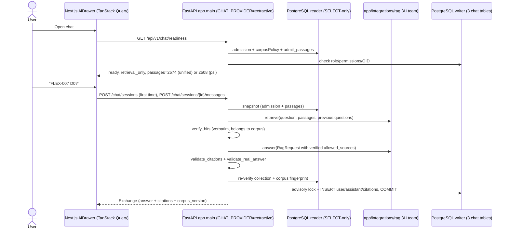

# NASA Chatbot (Extractive RAG): Workflow and Execution Guide

Updated 2026-11-15.

**Architecture:** Chat runs directly within this repository's backend. RAG plugs in via the
Phase 6 `RagProvider` extension point and is enabled with `CHAT_PROVIDER=extractive`. Decisions are documented at:
- [ADR-0005](../flameguard-ai-backend/docs/decisions/ADR-0005-real-corpus-extractive-chat.md)
- [Phase 6b spec](../flameguard-ai-backend/specs/phase6b-real-corpus-chat/spec.md)

**Answer scope:** The chatbot only extracts **verbatim** chunks that have been admitted: PSI
sources under their CC0 declaration, and NASA-authored article text under the separate rights
policy of [ADR-0006](../flameguard-ai-backend/docs/decisions/ADR-0006-challenge-source-ownership.md).
Citations are linked to a specific corpus version. CC0 is never assumed for NASA pages, images or
transcripts. No LLMs and no paid providers.
`review_status` is always `unreviewed`; the chatbot does not provide safe/unsafe conclusions.

## User Interaction Flow

1. **Open chat.** The panel (NASA-style research chat) opens over the app's blurred backdrop.
   FE calls `GET /chat/readiness`. If not `ready`, the Send button is disabled and a
   "Retry connection" button is shown.
2. **Send question.**
   - If the tab has no session yet, FE calls `POST /chat/sessions` and saves the session ID into
     `sessionStorage`.
   - Then it sends `POST /chat/sessions/{id}/messages`.
3. **Backend processing.**
   - Reads admission and corpus within the **same snapshot**.
   - Calls the provider's `retrieve` on admitted passages (BM25, VI/EN aliases, study/run
     anchors, with a deadline).
   - **Self-checks each hit**: source belongs to the corpus, excerpt is a verbatim slice of the chunk.
4. **Provider generates an answer** only from verified hits, preserving all conflicting values. For example,
   FLEX-007 D0: 1.87 mm per CSV, 1.82 mm per TestSheet. The provider refuses questions that:
   - demand safety conclusions;
   - ask about Lunar/Martian gravity;
   - are out of scope;
   - mix multiple runs.
5. **Backend validates `real` answer**: correct `corpus_version`, has `provider_version`,
   citations belong to the verified set, and all numbers (intact tokens) in the text are present in the excerpt. Afterwards,
   the backend re-checks the fingerprint and records user + assistant + citations in a single
   transaction. Errors return 502/409 and save nothing.
6. **Display.** "View source n" calls
   `GET /chat/sources/{source_document_id}?locator=…&corpus_version=…`. Citations for an
   outdated corpus return 409; the original excerpt in the message is preserved.
7. **History resides on server.**
   - The panel displays one history page (50 messages), plus new messages from this session.
   - "Conversation history" has Refresh / Previous / Next / Start new session.
   - Reloading the tab still recovers the session history.



## Code Layers

| Layer | File | Owner | Responsibility |
| --- | --- | --- | --- |
| UI | `FlameInFreewall_Tourbillion/src/components/ai/{AiDrawer,AiMessageItem,CitationBadge}.tsx` | FE | NASA-style panel on blurred backdrop, readiness, paginated history, citations |
| Hooks/Client | `src/hooks/api/useChatQueries.ts`, `src/api/{services/chatService,dto/chat,mappers/chatMapper}.ts` | FE | Matches snake_case contract; sends with 30s timeout; handles unmount, timeout, reset |
| Endpoint | `flameguard-ai-backend/app/api/v1/endpoints/chat.py` | BE | Sessions/messages, `/chat/readiness`, `/chat/sources/{id}` |
| Service | `app/services/chat.py` | BE | Snapshot, hit check, grounding, drift check, atomic write |
| Corpus admission | `app/services/corpus_policy.py`, `app/repositories/corpus.py` | BE | CC0 registry, hash, chunk/source reconciliation |
| Protocol | `app/integrations/chat.py` | BE | `RagProvider`, `CorpusRetriever`, `CorpusPassage`, `select_provider` |
| RAG | `app/integrations/rag/{retrieval,bm25,provider}.py` | AI | BM25, aliases, anchors, refusal rules, excerpt composition |
| Data | `integrations/nasa_data/{challenge,coverage,unified,xlsx,export,corpus_registry}.py` | Data | Offline NASA release (default `unified`, official sources only), 21-table snapshot, registry + `corpusPolicy` declaration. See `docs/DATA_HANDOFF.md` |

## Guarantees and Limitations

- **No schema changes:** Still 21 tables, no new migrations. Collections without
  `corpusPolicy` and `unavailable`/`mock` providers retain Phase 6 behavior.
- **Concurrency (ADR-0004):** Provider runs outside transactions, committed sequentially per session
  using advisory locks. Two concurrent questions may both see older history, but user/assistant
  pairs are always complete.
- **Size limits:**

  | Target | Limit |
  | --- | --- |
  | Question | ≤ 4000 characters |
  | History sent to provider | ≤ 12 messages / 12,000 characters |
  | Citations per answer | ≤ 4 |
  | History page (FE) | 50 messages |

  Retrieval and provider have a deadline of `CHAT_TIMEOUT_SECONDS`; timeouts are saved as `state=timeout`.
- **Session:** Session ID is a public demo token, not an authentication login. HTTP access logging is disabled.

## Re-running Locally

One-time setup:

```bash
python3.12 -m venv flameguard-ai-backend/.venv   # install deps according to flameguard-ai-backend/pyproject.toml
python3 scripts/test_db.py create                  # container tourbillion-test-pg, 127.0.0.1:55435
flameguard-ai-backend/.venv/bin/python scripts/prepare_chat_preview.py --prepare-new-test-target
```

The last command prints `.demo/nasa-chat-preview-<db>.json` (permissions 0600). This file contains `DATABASE_URL`,
`RUNTIME_DATABASE_URL`, `CATALOG_COLLECTION_MANIFEST`, and `CHAT_PROVIDER=extractive`.
The launcher runs `uvicorn app.main:app`:

```bash
flameguard-ai-backend/.venv/bin/python scripts/run_chat_backend.py --settings .demo/nasa-chat-preview-<db>.json --port 8112
```

```bash
cd FlameInFreewall_Tourbillion && BACKEND_INTERNAL_URL=http://127.0.0.1:8112 npm run dev -- -p 3312
```

When running in a real environment: set `CHAT_PROVIDER=extractive` and use the v2 manifest with
`corpusPolicy` (written by `integrations/nasa_data/corpus_registry.py`). To disable, remove either
of those two settings.

## Testing and Verification

```bash
cd flameguard-ai-backend && python3 ../scripts/test_db.py run -- .venv/bin/python -m pytest -q
```

```bash
python3 scripts/test_db.py run -- flameguard-ai-backend/.venv/bin/python -m pytest -q
```

```bash
cd FlameInFreewall_Tourbillion && npm test && npx tsc --noEmit && npm run build
```

Results as of 2026-11-14:

| Component | Result |
| --- | --- |
| Backend (PostgreSQL) | 679 passed: 650 existing tests unchanged + 29 new tests (policy, grounding, provider) |
| `integration_tests` (PostgreSQL, real NASA data) | 41 passed, 0 skip |
| FE | vitest 279 passed; `tsc` and `next build` pass |
| Browser smoke test (`app.main:app` + FE via proxy) | FLEX-007 returns 1.87/1.82 mm with citations; opens original CSV (CC0-1.0); reload preserves history; Enter sends follow-up question; Refresh history yields 2 message pairs |

`integration_tests` includes: fake citations and fabricated data (502), mid-session registry modification
(409), concurrent requests, provider and retrieval timeouts, provider lacking retrieve,
Advisor reporting `PROVIDER_UNAVAILABLE`, unknown sources (404), and outdated corpus (409).

This is a retrieval and persistence verification for the local demo, not a scientific or production evaluation.


## Quality fixes (2026-11-15)

Provider `nasa-extractive-v3` uses a bounded bilingual/chemistry vocabulary, recognises study
families and balances excerpts when comparing. Lead-in and refusal text follow the question's
language; excerpts stay verbatim. Questions that need aggregation across records (highest/lowest/
how many/range) abstain and point to Explorer unless a specific run code is named. Aggregate
numbers are never computed and presented as NASA statements.

Product evaluation set: `integration_tests/data/chat_eval.json` (40 questions, 20 EN/20 VI, split
and hash frozen before tuning). Development run:

```bash
PYTHONPATH=.:flameguard-ai-backend flameguard-ai-backend/.venv/bin/python -m integrations.nasa_data.chat_evaluation --split development
```

The ten holdout questions are run only after the retrieval rules are closed; results are reported
separately in `flameguard-ai-backend/specs/phase6b-real-corpus-chat/evaluation.md`. This is a small
team-authored benchmark, not scientific verification. The `playbook-rag/` prototype benchmark does
not apply to this chatbot.
