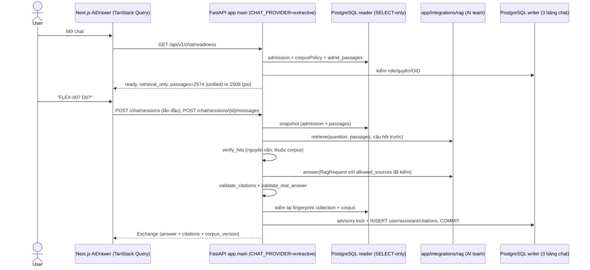

# Chatbot NASA (RAG extractive): luồng hoạt động và cách chạy

Cập nhật 2026-11-14.

**Kiến trúc:** chat chạy trong chính backend của repo này. RAG cắm vào qua extension point
`RagProvider` của Phase 6 và bật bằng `CHAT_PROVIDER=extractive`. Quyết định được ghi tại:
- [ADR-0005](../flameguard-ai-backend/docs/decisions/ADR-0005-real-corpus-extractive-chat.md)
- [spec Phase 6b](../flameguard-ai-backend/specs/phase6b-real-corpus-chat/spec.md)

**Phạm vi trả lời:** chatbot chỉ trích **nguyên văn** chunk của nguồn CC0 đã admit, kèm
citation gắn với một phiên bản corpus. Không có LLM và không có provider trả phí.
`review_status` luôn là `unreviewed`; chatbot không đưa kết luận safe/unsafe.

## Theo thao tác người dùng

1. **Mở chat.** Panel (style chat nghiên cứu kiểu NASA) mở trên nền mờ của app.
   FE gọi `GET /chat/readiness`. Nếu chưa `ready`, nút Send bị khóa và có nút
   "Retry connection".
2. **Gửi câu hỏi.**
   - Nếu tab chưa có session, FE gọi `POST /chat/sessions` rồi lưu session ID vào
     `sessionStorage`.
   - Sau đó gửi `POST /chat/sessions/{id}/messages`.
3. **Backend xử lý.**
   - Đọc admission và corpus trong **cùng một snapshot**.
   - Gọi `retrieve` của provider trên các passage đã admit (BM25, alias VI/EN, anchor
     study/run, có deadline).
   - **Tự kiểm từng hit**: nguồn thuộc corpus, excerpt là lát cắt nguyên văn của chunk.
4. **Provider tạo câu trả lời** chỉ từ các hit đã kiểm, giữ mọi giá trị mâu thuẫn. Ví dụ
   FLEX-007 D0: 1.87 mm theo CSV, 1.82 mm theo TestSheet. Provider từ chối các câu hỏi:
   - đòi kết luận an toàn;
   - về trọng lực Mặt Trăng/Sao Hỏa;
   - ngoài phạm vi;
   - trộn nhiều run.
5. **Backend kiểm câu trả lời `real`**: đúng `corpus_version`, có `provider_version`,
   citation nằm trong tập đã kiểm, và mọi số (token nguyên vẹn) trong text đều có trong excerpt. Sau đó
   backend kiểm lại fingerprint rồi ghi user + assistant + citations trong một
   transaction. Lỗi trả 502/409 và không lưu gì.
6. **Hiển thị.** "View source n" gọi
   `GET /chat/sources/{source_document_id}?locator=…&corpus_version=…`. Citation của
   corpus cũ trả 409; excerpt gốc trong tin nhắn vẫn giữ nguyên.
7. **Lịch sử nằm trên server.**
   - Panel hiển thị một trang lịch sử (50 tin), cộng thêm các tin mới của lần xem này.
   - "Conversation history" có Refresh / Previous / Next / Start new session.
   - Reload tab vẫn khôi phục được lịch sử của session.



## Các lớp code

| Lớp | File | Chủ sở hữu | Trách nhiệm |
| --- | --- | --- | --- |
| UI | `FlameInFreewall_Tourbillion/src/components/ai/{AiDrawer,AiMessageItem,CitationBadge}.tsx` | FE | Panel kiểu NASA trên backdrop mờ, readiness, history phân trang, citations |
| Hooks/Client | `src/hooks/api/useChatQueries.ts`, `src/api/{services/chatService,dto/chat,mappers/chatMapper}.ts` | FE | Đúng contract snake_case; gửi với timeout 30 s; xử lý unmount, timeout, reset |
| Endpoint | `flameguard-ai-backend/app/api/v1/endpoints/chat.py` | BE | Sessions/messages, `/chat/readiness`, `/chat/sources/{id}` |
| Service | `app/services/chat.py` | BE | Snapshot, kiểm hit, grounding, kiểm drift, ghi atomic |
| Corpus admission | `app/services/corpus_policy.py`, `app/repositories/corpus.py` | BE | Registry CC0, hash, đối chiếu từng chunk/source |
| Protocol | `app/integrations/chat.py` | BE | `RagProvider`, `CorpusRetriever`, `CorpusPassage`, `select_provider` |
| RAG | `app/integrations/rag/{retrieval,bm25,provider}.py` | AI | BM25, alias, anchor, quy tắc từ chối, ghép trích đoạn |
| Data | `integrations/nasa_data/{challenge,coverage,unified,xlsx,export,corpus_registry}.py` | Data | Release NASA offline (mặc định `unified`, chỉ nguồn chính thức), snapshot 21 bảng, registry + khai báo `corpusPolicy`. Xem `docs/DATA_HANDOFF.md` |

## Bảo đảm và giới hạn

- **Không đổi schema:** vẫn 21 bảng, không có migration mới. Collection không có
  `corpusPolicy` và các provider `unavailable`/`mock` giữ nguyên hành vi Phase 6.
- **Đồng thời (ADR-0004):** provider chạy ngoài transaction, commit tuần tự theo session
  bằng advisory lock. Hai câu gửi cùng lúc có thể cùng thấy lịch sử cũ, nhưng các cặp
  user/assistant luôn đầy đủ.
- **Giới hạn kích thước:**

  | Đối tượng | Giới hạn |
  | --- | --- |
  | Câu hỏi | ≤ 4000 ký tự |
  | History gửi cho provider | ≤ 12 tin / 12000 ký tự |
  | Citations mỗi câu trả lời | ≤ 4 |
  | Trang history (FE) | 50 tin |

  Retrieval và provider có deadline `CHAT_TIMEOUT_SECONDS`; quá hạn thì lưu `state=timeout`.
- **Session:** session ID là token demo công khai, không phải đăng nhập. Access log HTTP được tắt.

## Chạy lại (local)

Chuẩn bị một lần:

```bash
python3.12 -m venv flameguard-ai-backend/.venv   # cài deps theo flameguard-ai-backend/pyproject.toml
python3 scripts/test_db.py create                  # container tourbillion-test-pg, 127.0.0.1:55435
flameguard-ai-backend/.venv/bin/python scripts/prepare_chat_preview.py --prepare-new-test-target
```

Lệnh cuối in ra `.demo/nasa-chat-preview-<db>.json` (quyền 0600). File này có `DATABASE_URL`,
`RUNTIME_DATABASE_URL`, `CATALOG_COLLECTION_MANIFEST` và `CHAT_PROVIDER=extractive`.
Launcher chạy `uvicorn app.main:app`:

```bash
flameguard-ai-backend/.venv/bin/python scripts/run_chat_backend.py --settings .demo/nasa-chat-preview-<db>.json --port 8112
```

```bash
cd FlameInFreewall_Tourbillion && BACKEND_INTERNAL_URL=http://127.0.0.1:8112 npm run dev -- -p 3312
```

Khi chạy trên môi trường thật: đặt `CHAT_PROVIDER=extractive` và dùng manifest v2 có
`corpusPolicy` (do `integrations/nasa_data/corpus_registry.py` ghi). Muốn tắt thì bỏ một
trong hai thứ đó.

## Kiểm tra

```bash
cd flameguard-ai-backend && python3 ../scripts/test_db.py run -- .venv/bin/python -m pytest -q
```

```bash
python3 scripts/test_db.py run -- flameguard-ai-backend/.venv/bin/python -m pytest -q
```

```bash
cd FlameInFreewall_Tourbillion && npm test && npx tsc --noEmit && npm run build
```

Kết quả ngày 2026-11-14:

| Phần | Kết quả |
| --- | --- |
| Backend (PostgreSQL) | 679 passed: 650 test cũ không phải sửa + 29 test mới (policy, grounding, provider) |
| `integration_tests` (PostgreSQL, dữ liệu NASA thật) | 41 passed, 0 skip |
| FE | vitest 279 passed; `tsc` và `next build` pass |
| Smoke trên trình duyệt (`app.main:app` + FE qua proxy) | FLEX-007 ra 1.87/1.82 mm có citation; mở được CSV gốc (CC0-1.0); reload vẫn còn history; Enter gửi câu nối tiếp; Refresh history ra 2 cặp tin |

`integration_tests` bao gồm: citation giả và số liệu bịa (502), registry đổi giữa chừng
(409), gửi đồng thời, timeout của provider và retrieval, provider không có retrieve,
Advisor báo `PROVIDER_UNAVAILABLE`, nguồn lạ (404) và corpus cũ (409).

Đây là xác minh truy xuất và lưu trữ cho bản demo local, không phải đánh giá khoa học hay production.
