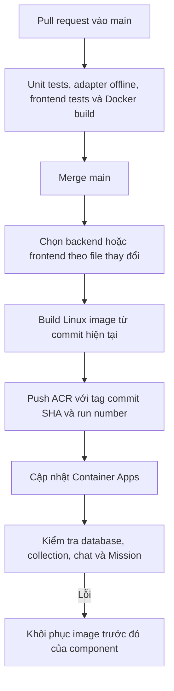

# GitHub Actions và Azure deployment

PR #8 cần cập nhật dữ liệu trước khi kích hoạt deployment. Xem
[quy trình import và rollout PR #8](pr8-data-rollout.md). Checksum production chỉ
được cập nhật sau khi database import thành công bằng `--activate-config`.

Workflow deployment được kích hoạt sau khi các file trong PR này được merge vào `main`.



`.github/workflows/ci.yml` chạy trên PR. Backend kiểm tra unit, Alembic offline,
adapter NASA và Docker build. Frontend kiểm tra Vitest, TypeScript và Docker build.
PostgreSQL integration tests chạy trên container test riêng theo `AGENTS.md` khi kiểm
tra local. Kết quả CI ghi riêng nhóm offline.

`.github/workflows/deploy.yml` chạy sau push vào `main` và hỗ trợ **Run workflow**
trên `main`. Workflow deployment chạy tuần tự để các lượt rollout hoàn tất đầy đủ.
Thay đổi frontend chọn frontend, thay đổi backend hoặc adapter chọn backend, thay đổi
cấu hình deployment chung chọn cả hai. Các file tài liệu độc lập được bỏ qua.

Backend được cập nhật trước frontend khi cả hai thay đổi. Mỗi component có rollback
riêng. Lượt deploy lỗi báo failed sau khi khôi phục image trước đó. Script kiểm tra
image hiện tại trước rollback để bảo toàn một deployment khác vừa hoàn tất.

## Azure OIDC

Identity `id-flameguard-github` có federated credential với các giá trị sau.

| Thuộc tính | Giá trị |
| --- | --- |
| Issuer | `https://token.actions.githubusercontent.com` |
| Subject | `repo:hieuduong1810/TourbillionSG-FlameInFreefall:ref:refs/heads/main` |
| Audience | `api://AzureADTokenExchange` |
| ACR role | `AcrPush`, scope `acrflameguard` |
| Deployment role | `Container Apps Contributor`, scope từng app `ca-flameguard-api` và `ca-flameguard-web` |

Repository variables dùng trong Azure Login gồm `AZURE_CLIENT_ID`, `AZURE_TENANT_ID`
và `AZURE_SUBSCRIPTION_ID`. Database credentials tiếp tục lấy từ Container App secrets.
Các Actions chính thức được pin bằng commit SHA.

Repo hiện có tên chính thức `hieuduong1810/TourbillionSG-FlameInFreefall`.
Đã cập nhật federated credential `github-main` theo tên này; URL `bachkhmt/...`
chuyển hướng sang repo hiện tại. Nếu repo đổi tên/chủ sở hữu lần nữa, phải kiểm tra
lại subject OIDC trước khi deploy.

## Bundle NASA

`deploy/azure/production.json` chứa resource names, public URLs và binding của database
đã import, gồm OID, reader role, source revision và checksum nội dung snapshot.
`prepare-bundle.py` tái tạo bundle offline từ các nguồn trong Git rồi dùng
`write_corpus_policy` để tạo corpus registry và Mission research sidecar.

Khi bundle khác dữ liệu đã import, bước prepare báo lỗi trước rollout. Với dataset
mới, operator import bundle, xác nhận OID/reader/source revision rồi cập nhật binding
trong `production.json`. Migration và ingestion là các thao tác do operator thực hiện.

## Chạy từ laptop

Từ root repo, dùng Python của backend và phiên Azure CLI đã đăng nhập.

```powershell
.\flameguard-ai-backend\.venv\Scripts\python.exe deploy/azure/release.py deploy backend --tag git-COMMIT-RELEASE
.\flameguard-ai-backend\.venv\Scripts\python.exe deploy/azure/release.py deploy frontend --tag git-COMMIT-RELEASE
```

Chọn tag mới cho mỗi lần release. Script build backend base từ checkout hiện tại,
đóng gói bundle đã bind, push image và gọi `az containerapp update --image`.
`BACKEND_INTERNAL_URL` của frontend được đưa vào lúc build theo `production.json`.

```powershell
.\flameguard-ai-backend\.venv\Scripts\python.exe deploy/azure/release.py smoke backend
.\flameguard-ai-backend\.venv\Scripts\python.exe deploy/azure/release.py smoke frontend
```

Standard GitHub-hosted runner cho repo public được miễn phí compute. Repo private sử
dụng hạn mức của chủ repo. Chi phí Azure và storage tính theo tài nguyên thực tế.

## Xác minh ngày 2026-11-15

- Đã merge main tại `b9bc971` vào nhánh deployment.
- Backend release `git-269a2e7be0b8-20261115123513` đã chạy trên Azure.
- Frontend release `git-269a2e7be0b8-20261115123637` đã chạy trên Azure.
- Kiểm tra database, collection NASA, chat readiness và Mission research qua backend
  cùng frontend proxy đều đạt.
- Backend unit/deployment có 263 test passed. Adapter offline/deployment có 111 test
  passed, 14 integration test deselected. Frontend có 310 test passed, TypeScript đạt.
- Hai workflow qua actionlint. Lượt chạy OIDC trên GitHub được xác nhận sau merge main.
