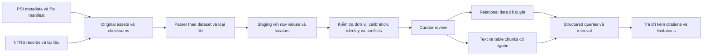

# Dữ liệu NASA combustion cho FlameGuard AI

Ngày nghiên cứu: **10-11-2026**. Đây là nghiên cứu đầu vào, chưa phải đặc tả được duyệt hoặc phần ingestion đã triển khai.

**Có đủ dữ liệu thật để bắt đầu ingestion và RAG ngay theo từng họ thí nghiệm.** Khó khăn chính là khác biệt về mức chi tiết, định dạng, calibration và provenance. Không nên chờ một bộ dữ liệu NASA thống nhất, cũng không nên coi tất cả CSV là bảng run hoặc nhúng toàn bộ raw data vào vector database.

## 1. Phạm vi đã kiểm tra thực tế

- Đọc metadata JSON của **18 investigations**, tải **20 bảng CSV** tương ứng.
- Đọc file manifest của **6 investigations**: FLEX, BASS-II, Saffire-I, Saffire-II, SAME và ACME CLD Flame.
- Tải thêm **5 file TXT** của FLEX và **3 tài liệu DOCX** hướng dẫn FLEX/BASS-II/Saffire. Tổng 28 artifact nhỏ: **339.134 byte**, giữ nguyên byte và SHA-256.
- Lấy metadata và bản fulltext do NTRS cung cấp của 4 báo cáo; đọc các mục liên quan đến phương pháp, đơn vị và nguồn dữ liệu. Không đọc toàn bộ mọi paper hoặc kiểm tra mọi hình.
- Chỉ thêm tài liệu nghiên cứu; chưa ghi vào DB, chưa thay đổi app, ERD, migrations hoặc FE.

Nguồn và cách truy cập nằm trong [sources.json](sources.json). Metadata, header và version trong [catalog-snapshot.json](evidence/catalog-snapshot.json); file đã tải trong [artifacts.json](evidence/artifacts.json). Số dòng bên dưới được tính trên file gốc, không lấy số hàng UI làm số test đã xác minh.

## 2. Nguồn nào dùng cho mục đích nào

| Nguồn | Dùng được cho | Giới hạn đã quan sát |
| --- | --- | --- |
| [NASA PSI](https://psi.nasa.gov/physci/repo/) | Accession, DOI, version, experimental tables, raw/analyzed files, calibration, tài liệu và publications | Trang là SPA; HTML rỗng không có nghĩa thiếu dữ liệu. Các endpoint website đã hoạt động khi kiểm tra nhưng chưa tìm thấy hợp đồng API PSI được công bố |
| [NASA NTRS](https://www.sti.nasa.gov/harvesting-data-from-ntrs/) | Báo cáo, phương pháp, limitations, giải nghĩa dữ liệu, citations cho RAG | Metadata công khai không bảo đảm mọi fulltext đều có cùng quyền sử dụng; đọc tình trạng từng record |
| NASA experiment/mission pages | Discovery, mục tiêu, hardware và bối cảnh | Mục tiêu nghiên cứu không phải kết quả đã đo; ảnh minh họa không phải telemetry |
| [NASA PSI trên AWS](https://registry.opendata.aws/nasa-psi/) | Một đường truy cập dữ liệu PSI được giới thiệu chính thức | Root bucket kiểm tra chỉ hiện `DSI/`, `OASIS/`, `pk4/`; không đủ cơ sở coi đây là mirror combustion |

[PSI Database Guide](https://assets.science.nasa.gov/content/dam/science/bps/bps-general/bps-data_osdr_psi/Complete_PSI_Database_Guide.pdf), mục Experiment Table / Data Files / Version History, xác nhận cách phân loại và tải dữ liệu. Metadata của 18 bộ đã kiểm tra khai báo `CC0-1.0`; vẫn giữ DOI và version khi trích dẫn. Đây không phải kết luận về mọi tài liệu liên kết ngoài PSI.

## 3. Bản đồ các họ thí nghiệm

Các accession dưới đây đã lấy được JSON và CSV. “Dòng” là dòng dữ liệu không rỗng sau header, **không đồng nghĩa số run độc lập**. Chỉ số scope là snapshot ngày nghiên cứu, không phải toàn bộ NASA.

| Họ / accession | Dữ liệu quan sát trong CSV | Mức chi tiết và ý nghĩa với ingestion |
| --- | --- | --- |
| [FLEX, PSI-69](https://psi.nasa.gov/physci/repo/data/investigations/PSI-69) | 274 dòng; test ID, fuel, áp suất mmHg, thành phần khí, đường kính, burning rate, burn time, test end | Phù hợp làm pilot run-level; cần đối chiếu test sheet và báo cáo phương pháp |
| [FLEX-2, PSI-68](https://psi.nasa.gov/physci/repo/data/investigations/PSI-68) | 8 dòng nhiên liệu/hỗn hợp, các dải diameter, oxygen, pressure, flow | Bảng miền thử nghiệm; không tạo 8 run và không lấy tích Descartes các dải làm thí nghiệm thật |
| [BASS, PSI-26](https://psi.nasa.gov/physci/repo/data/investigations/PSI-26) | 122 dòng; ngày, as-run test, test, sample, vật liệu | Có định danh test/sample; thiếu điều kiện đầy đủ trong bảng tóm tắt |
| [BASS-II, PSI-25](https://psi.nasa.gov/physci/repo/data/investigations/PSI-25) | 129 dòng; PI/test/sample, mô tả vật liệu, fan/air display, O2/CO2/CO trước-sau | Rất phù hợp cho bài toán solid materials, nhưng phải đọc README, test matrices và calibration |
| [Saffire-I, PSI-98](https://psi.nasa.gov/physci/repo/data/investigations/PSI-98) | 4 dòng, gồm 2 mẫu và 2 dòng flow-visualization | Phân loại sample, flow record và camera asset riêng |
| [Saffire-II, PSI-99](https://psi.nasa.gov/physci/repo/data/investigations/PSI-99) | 15 dòng: 9 sample, 2 flow records, 4 notes | Có vật liệu/geometry/flow/outcome; nhiều ô chứa đơn vị hoặc kết quả định tính |
| [Saffire-III, PSI-100](https://psi.nasa.gov/physci/repo/data/investigations/PSI-100) | 2 dòng sample, có geometry và hướng dòng | Dataset riêng với DOI/version riêng; không gộp vào Saffire-I |
| ACME [BRE, PSI-20](https://psi.nasa.gov/physci/repo/data/investigations/PSI-20), [CLD, PSI-21](https://psi.nasa.gov/physci/repo/data/investigations/PSI-21), [E-FIELD, PSI-22](https://psi.nasa.gov/physci/repo/data/investigations/PSI-22), [s-Flame, PSI-23](https://psi.nasa.gov/physci/repo/data/investigations/PSI-23) | Lần lượt 18, 32, 32, 18 dòng; ngày thử, nhóm cấu hình, số flames và notes | Chủ yếu bảng tổng hợp theo ngày/cấu hình. E-FIELD còn có dòng tiếp diễn, không có test-day riêng |
| [ACME Flame Design, PSI-10](https://psi.nasa.gov/physci/repo/data/investigations/PSI-10) | Hai bảng normal/inverse: 207 và 120 dòng; Test, composition, mass flow, pressure đầu/cuối, Zst, Tad | Có test keys và số liệu phong phú; không coi mọi cột số là measurement trực tiếp |
| [ACME CFI-G, PSI-159](https://psi.nasa.gov/physci/repo/data/investigations/PSI-159) | Normal 179 dòng; inverse 154 dòng không rỗng trong 1.015 dòng sau header | Có failed ignition, self-extinction/flow termination và comments; phải bỏ blank records có kiểm soát |
| [CFI, PSI-39](https://psi.nasa.gov/physci/repo/data/investigations/PSI-39) | 87 dòng; FLEX number, CIR key, pressure, gases, fiber, fuel, local time | Không nhầm với CFI-G; thời gian có nhãn `est`, không tự gắn UTC |
| [SLICE, PSI-106](https://psi.nasa.gov/physci/repo/data/investigations/PSI-106), [SPICE, PSI-107](https://psi.nasa.gov/physci/repo/data/investigations/PSI-107) | SLICE: 12 dòng ngày/fuel; SPICE: 469 dòng với giờ, nozzle, fuel/air flows | Hai cấu trúc khác nhau; một dòng SPICE chưa đủ chứng minh một ignition độc lập |
| [SAME, PSI-102](https://psi.nasa.gov/physci/repo/data/investigations/PSI-102), [SAME-R, PSI-101](https://psi.nasa.gov/physci/repo/data/investigations/PSI-101) | SAME: 8 dòng sample/conditions; SAME-R: 109 dòng test với aging/mixing time | Mở rộng corpus về smoke/aerosol; không chuyển dữ liệu aerosol thành flame-spread measurement |

ACME là một suite các thí nghiệm khí; BRE dùng burner để mô phỏng cháy condensed fuels, không phải đo trực tiếp mọi vật liệu solid được nhắc tới. Báo cáo [NTRS 20220005205](https://ntrs.nasa.gov/citations/20220005205), phần 2-3, cũng mô tả chamber constant-volume và nhiều diagnostics; áp suất/composition đầu-cuối không mặc định không đổi trong run.

## 4. Raw data thực sự trông như thế nào

[Manifest snapshot](evidence/manifest-summaries.json) chứa request body đã dùng và selected entries để kiểm tra lại:

| Investigation | File entries trong manifest | Định dạng đáng chú ý |
| --- | ---: | --- |
| FLEX | 6.555 | TXT, ZIP, PDF, RTF, MP4, XLS, CSV, DOCX |
| BASS-II | 695 | MP4, ZIP, PDF, XLSX, DOCX, PPTX, JPG, CSV |
| Saffire-I | 76 | ZIP, XLSX, DOCX, PDF, CSV |
| Saffire-II | 222 | ZIP, XLSX, DOCX, PDF, CSV |
| SAME | 105 | XLS đời cũ, XLSX, XML, ZIP, PDF, video, documents |
| ACME CLD | 4.883 | CSV, TXT, LOG, ZIP, MP4, XLSX, PDF và extensions chuyên dụng |

Đây là file entries bên ngoài archive, không phải danh sách mọi frame bên trong ZIP. Không tải/giải nén video hay toàn bộ archives trong lần nghiên cứu này. `totalFileSize` trong catalog khai báo FLEX khoảng 0,924 TB và CLD khoảng 2,006 TB theo byte thập phân; không phải số byte đã tải, dung lượng unique hoặc chi phí storage đã kiểm chứng.

Mẫu FLEX-007 đã đọc trực tiếp:

- `TestSheet.txt`: điều kiện ambient, CIR identifier, fuel, fiber và phần nhận xét chất lượng quan sát.
- `DropletData.txt`: chuỗi thời gian, đường kính và vị trí; có thời gian âm và các ô vị trí trống.
- `LLUVData.txt`: một timebase khác, flame diameter, standoff và vị trí; có ô trống.
- Calibration TXT: chamber gas note và testpoint settings. Đuôi `.txt` có thể chứa bảng phân cách tab hoặc CSV, không chỉ văn xuôi.

Thiết kế asset/time-series phải giữ channel, unit, time origin và missingness. Không ép mọi channel về cùng sampling grid nếu chưa có phương pháp resampling được duyệt. Xem [artifacts.json](evidence/artifacts.json) để truy lại file/version/hash.

## 5. Các vấn đề chất lượng đã chứng minh bằng file

Chi tiết, locator và đối chiếu trong [quality-findings.md](evidence/quality-findings.md).

1. **Nguồn có thể mâu thuẫn.** FLEX-007/20CAL13: CSV ghi initial diameter `1.87`, burning-rate value `0.67`; test sheet ghi `1.82` và `0.68`. Không chọn một giá trị hoặc lấy trung bình âm thầm.
2. **Header không đủ để hiểu đơn vị.** FLEX CSV ghi `Burning rate; mm`; test sheet và [NTRS 20150023456](https://ntrs.nasa.gov/citations/20150023456), Appendix A/Table IX, dùng `mm²/s` cho burning-rate constant. Lưu cả nhãn gốc và mapping có nguồn xác nhận.
3. **Có hướng dẫn sửa ngữ cảnh thời gian.** BASS-II README giải thích ngày trên video lệch một ngày vì xử lý leap year; GMT trong bảng là day-of-year. Không dùng metadata video làm ngày thí nghiệm mà bỏ qua hướng dẫn.
4. **Calibration ảnh hưởng ý nghĩa số đo.** BASS-II README định nghĩa fan display, độ trễ air display, radiometer chưa calibration tuyệt đối và O2 đã hiệu chỉnh offset. `OR` là vượt thang `>1000 ppm`, không phải missing hoặc giá trị chính xác 1000.
5. **Missing, qualitative và anomaly phải khác nhau.** Có `none`, `n/a`, `Insignificant`, khoảng số, nhiều mức flow trong một ô và số CO âm. BASS-II T28b có final O2 `40.4` trong cả CSV và fulltext báo cáo; cần review, chưa đủ cơ sở tự sửa thành số khác.
6. **Chất lượng biểu diễn khác nhau.** FLEX CSV không decode được UTF-8; CP1252 đọc được. CFI-G inverse có 861 dòng rỗng. Một số bảng chứa notes hoặc dòng tiếp diễn. Parser phải kiểm tra encoding và loại hàng trước khi tạo records.
7. **Filename có thể chứa identity cũ.** Metadata ZIP của BASS-II nằm dưới PSI-25 nhưng tên còn chứa `PSI-101`; accession hiện tại PSI-101 là SAME-R. Canonical identity phải theo record/manifest hiện tại, không lấy một mã PSI bất kỳ từ filename.

## 6. Thiết kế ingestion nên bắt đầu như thế nào

Đây là đề xuất từ kết quả khảo sát, **chưa thay đổi hợp đồng hoặc schema hiện có**.

**Discovery và acquisition:** bắt đầu từ accession + DOI + study version; lấy manifest trước, ưu tiên README/data dictionary/calibration và experimental table. Fetch file nhỏ có chọn lọc; chỉ tải raw archives cho câu hỏi cụ thể. Signed download URL là đường vận chuyển tạm thời; identity phải gồm accession, version, file ID/path và checksum.

**Staging:** giữ nguyên file gốc; mỗi giá trị có raw text, parsed value, original unit, source locator, parser version và trạng thái review. Phân loại cấp độ `investigation / campaign / test-day / sample / run / frame / time-series`, không tạo run giả từ dải tham số. Các nhãn này là đề xuất staging, không phải enum mới trong DB.

**Normalization:** xử lý Decimal; O2 mole fraction và phần trăm có mapping tường minh; phân biệt pressure tuyệt đối và relative nếu nguồn cho biết; lưu các đơn vị mmHg/atm/bar trước khi đổi sang đơn vị hiển thị. Không suy ra cm/s từ mass flow mg/s hoặc standard volumetric flow khi thiếu khí, trạng thái chuẩn và geometry. Không dùng `Tad` như nhiệt độ đo bằng sensor khi chưa rõ phương pháp.

**Validation:** kiểm tra run identity, liên kết asset, vocabulary, calibration và phạm vi coverage. Chỉ gom dữ liệu tương thích trong cùng run/ngữ cảnh. Re-import cùng file/version/hash phải idempotent; bản mới là revision, không ghi đè evidence lịch sử. Conflict giữ cả hai ứng viên và mở `ImportIssue`.

## 7. Mapping vào backend hiện tại

| Đầu vào / tác vụ | Entity đang có | Điều phải giữ hoặc khoảng trống |
| --- | --- | --- |
| Metadata investigation | `Investigation`, `Tag`, `InvestigationTag` | `psi_id` giữ accession. DOI/license/version metadata đầy đủ vẫn cần manifest; không nhét vào title |
| Test đã xác nhận | `TestRun` | `external_run_key` chỉ một trường; FLEX cho thấy cần giữ thêm alias trong staging/manifest hoặc xin duyệt storage mapping |
| Điều kiện ban đầu / categorical | `TestCondition` | Giữ variable, numeric/text, unit và data_status; không nạp range summary thành điều kiện của run giả |
| Scalar observation | `Measurement` | Chỉ ghi khi hiểu observable/unit; uncertainty thiếu thì null. Không có cột thời gian cho mỗi sample telemetry |
| File/time-series | `Measurement.raw_asset_ref` và kho original assets | Asset manifest cần version/channel/time/calibration mapping; chưa có contract được duyệt |
| Dataset/doc và claim | `SourceDocument`, `EvidenceClaim`, `ClaimSource` | Claim chỉ được xuất bản sau review. Giữ nhiều nguồn và locator; không tự sinh finding từ mục Objectives |
| RAG | `DocumentChunk`, `ChatSession`, `ChatMessage`, `MessageCitation` | Trích về source + locator; chunk index/embedding phải gắn với đúng source revision |
| Theo dõi import | `IngestionJob`, `ImportIssue` | Không có FK từ job đến mọi row/asset đã import; giữ execution manifest trước khi đề xuất schema mở rộng |

**Các quyết định cần chốt trước ingestion production:** manifest/object storage contract; alias và revision identity; measurement-to-source/calibration provenance; encoding outcome định tính/boolean và interval/censoring; thuật ngữ status/unit; chính sách nguồn mâu thuẫn. Không tự thêm cột hoặc coi association gián tiếp cùng investigation là bằng chứng trực tiếp cho một measurement.

## 8. RAG phù hợp với dữ liệu này

Nên kết hợp **truy vấn dữ liệu có cấu trúc và tìm tài liệu**, với routing theo câu hỏi:

- Hỏi mục tiêu/hardware/phương pháp: retrieve metadata, README, reports theo investigation; trả rõ đây là mô tả nghiên cứu.
- Hỏi test nào có material/O2/pressure/airflow cụ thể: lọc relational data đã duyệt, rồi lấy source rows và diễn giải. Không để vector similarity thay việc kiểm tra điều kiện.
- Hỏi kết quả số: tính bằng query/code trên các giá trị và unit tương thích; đưa kết quả tính cùng source rows cho LLM. Không đếm dòng summary như số test.
- Hỏi chuỗi thời gian hoặc hình ảnh: dùng asset adapter riêng; text embedding của filename không chứng minh nội dung video hay sensor history.
- Hỏi Moon/Mars: tách quan sát microgravity khỏi extrapolation sang partial gravity; không biến topical relevance thành kết luận an toàn.

Chunk theo section/paragraph/table row, gắn accession, study/file version, locator và identity test khi có. Với PDF, giữ printed page/table/figure; bản fulltext NTRS có thể chứa markup và mất layout nên cần QA bảng/hình trước khi dùng số liệu. Với DOCX, giữ heading/paragraph/table và quan hệ với ảnh; trích XML không đọc được bảng sensor nằm trong hình.

Không ép tất cả tài liệu thành `EvidenceClaim`: một README có thể hữu ích trực tiếp cho RAG mà chưa có scientific finding đã duyệt. Khi thiếu nguồn hoặc có conflict, trả lời sự thiếu/mâu thuẫn đó và dẫn cả hai nguồn.

## 9. Thứ tự triển khai đề xuất

1. **Pilot kép FLEX + BASS-II:** một droplet test và một nhóm solid-material tests; thử metadata, CSV, TXT, DOCX, calibration, alias và conflicts. Nạp staging trước, chưa publish hàng loạt.
2. **RAG về phương pháp có citations:** README và các mục báo cáo đã review; bộ câu hỏi kiểm tra gồm units, missing values, calibration và nguồn mâu thuẫn.
3. **Run ingestion đã duyệt:** mở rộng có chọn lọc BASS-II/FLEX, bổ sung Saffire-II để thử notes, geometry và categorical outcomes.
4. **Các ACME phong phú hơn:** Flame Design/CFI-G để kiểm tra normal/inverse, mixture, derived variables và changing conditions; tách BRE/CLD/E-FIELD summary khỏi run-level records.
5. **SAME/SAME-R và assets lớn:** thêm aerosol semantics và telemetry/image processing khi đã có nhu cầu, manifest contract và tiêu chí verification cụ thể.

Pilot đạt khi có thể truy từ câu trả lời về đúng file/version/row; re-import không nhân bản; `OR` không biến thành zero; summary không biến thành run; FLEX conflict được giữ; và câu hỏi không đủ coverage nhận câu trả lời giới hạn thích hợp. Đây là acceptance criteria đề xuất, chưa phải test đã chạy.

## 10. Giới hạn và việc chưa xác minh

- Search từ khóa `combustion` trả 26 hits, trong đó 24 gắn Research Area = Combustion Science; đây không phải chứng minh toàn bộ catalog có đúng 24 investigation combustion. Cần filter/pagination để làm census.
- Search `Saffire` chỉ trả I/II/III; tài liệu Saffire V có trên NTRS. Chưa xác minh raw public package của IV/V/VI. Search `SoFIE` chỉ trả BASS-II có nhắc SoFIE; không kết luận SoFIE không có dữ liệu ở nguồn khác.
- Chưa tải các spreadsheet telemetry/calibration, nội dung bên trong ZIP và video; chưa xác minh mọi channel, sampling rate, sensor error hay khả năng liên kết file-run ở toàn bộ corpus.
- Web reader không mở được hai PDF FLEX/BASS-II lớn khoảng 43/49 MB; thay bằng fulltext liên kết trong record NTRS. Chưa visual QA bảng/hình của hai PDF này.
- Chưa tìm thấy tài liệu hợp đồng API PSI chính thức. Các endpoint quan sát được cần adapter, retry/backoff và fallback tải thủ công; không mặc định dùng API OSDR omics cho accession PSI.
- Chưa có embedding/model/vector store được chọn hoặc chạy, chưa đánh giá retrieval quality, chưa chứng minh prediction khả dụng.

## Tài liệu đi kèm

- [Ghi chú truy cập và nguồn](evidence/access-and-provenance.md)
- [Các phát hiện chất lượng với locator](evidence/quality-findings.md)
- [Nguồn đã đọc](sources.json)
- [Catalog snapshot](evidence/catalog-snapshot.json), [discovery snapshot](evidence/discovery-snapshot.json)
- [Manifest summaries](evidence/manifest-summaries.json), [artifact registry](evidence/artifacts.json)

Các file dưới `evidence/samples/` là dữ liệu gốc từ nguồn, không phải seed data của ứng dụng hay dữ liệu đã được curator duyệt.

Kiểm tra offline đã chạy: JSON hợp lệ; đủ 18 metadata projections và 20 CSV; header/số dòng khớp các file; toàn bộ 28 artifact khớp SHA-256 và kích thước metadata; links Markdown nội bộ tồn tại. Không chạy app tests hay kiểm chứng kết quả khoa học của các thí nghiệm.
