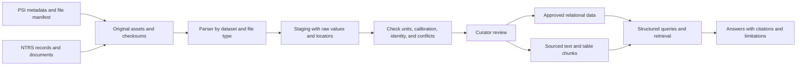

# NASA Combustion Data for FlameGuard AI

Research date: **2026-11-10**. This is input research, not yet an approved specification or implemented ingestion pipeline.

**There is sufficient real data to begin ingestion and RAG immediately by experiment family.** The main challenges are discrepancies in level of detail, format, calibration, and provenance. We should not wait for a unified NASA dataset, nor should we treat all CSVs as run tables or embed all raw data into a vector database.

## 1. Scope Actually Inspected

- Read JSON metadata for **18 investigations**, downloaded the corresponding **20 CSV tables**.
- Read file manifests for **6 investigations**: FLEX, BASS-II, Saffire-I, Saffire-II, SAME, and ACME CLD Flame.
- Downloaded an additional **5 TXT files** for FLEX and **3 DOCX guide documents** for FLEX/BASS-II/Saffire. Total of 28 small artifacts: **339,134 bytes**, preserving original bytes and SHA-256.
- Retrieved metadata and NTRS-provided fulltext for 4 reports; read sections related to methodology, units, and data sources. Did not read every paper in full or inspect every figure.
- Only added research documentation; no writes to DB, no changes to app, ERD, migrations, or FE.

Sources and access methods are in [sources.json](sources.json). Metadata, headers, and versions are in [catalog-snapshot.json](evidence/catalog-snapshot.json); downloaded files are in [artifacts.json](evidence/artifacts.json). Line counts below are calculated from the original files, without treating UI row counts as verified test counts.

## 2. Which Sources Serve Which Purposes

| Source | Usable for | Observed Limitations |
| --- | --- | --- |
| [NASA PSI](https://psi.nasa.gov/physci/repo/) | Accession, DOI, version, experimental tables, raw/analyzed files, calibration, documents, and publications | Site is an SPA; empty HTML does not mean missing data. Website endpoints were functional during testing, but no published PSI API contract was found |
| [NASA NTRS](https://www.sti.nasa.gov/harvesting-data-from-ntrs/) | Reports, methodology, limitations, data interpretation, citations for RAG | Public metadata does not guarantee all fulltext has the same usage rights; check the status of each record |
| NASA experiment/mission pages | Discovery, objectives, hardware, and context | Research objectives are not measured results; illustrative photos are not telemetry |
| [NASA PSI on AWS](https://registry.opendata.aws/nasa-psi/) | An officially promoted access route for PSI data | Inspected root bucket only shows `DSI/`, `OASIS/`, `pk4/`; insufficient basis to consider this a combustion mirror |

[PSI Database Guide](https://assets.science.nasa.gov/content/dam/science/bps/bps-general/bps-data_osdr_psi/Complete_PSI_Database_Guide.pdf), sections Experiment Table / Data Files / Version History, confirms data categorization and download procedures. Metadata for the 18 examined datasets declares `CC0-1.0`; retain DOI and version when citing. This is not a conclusion regarding all externally linked documents outside PSI.

## 3. Map of Experiment Families

The accessions below have had their JSON and CSV retrieved. "Rows" refers to non-empty data rows after the header, **not synonymous with independent run counts**. Scope numbers represent the snapshot on the research date, not all of NASA.

| Family / Accession | Observed Data in CSV | Level of Detail and Ingestion Implications |
| --- | --- | --- |
| [FLEX, PSI-69](https://psi.nasa.gov/physci/repo/data/investigations/PSI-69) | 274 rows; test ID, fuel, pressure mmHg, gas composition, diameter, burning rate, burn time, test end | Suitable as a run-level pilot; requires cross-referencing test sheets and methodology reports |
| [FLEX-2, PSI-68](https://psi.nasa.gov/physci/repo/data/investigations/PSI-68) | 8 rows of fuel/mixture, diameter ranges, oxygen, pressure, flow | Test domain table; do not create 8 runs and do not take Cartesian product of ranges as real experiments |
| [BASS, PSI-26](https://psi.nasa.gov/physci/repo/data/investigations/PSI-26) | 122 rows; date, as-run test, test, sample, material | Contains test/sample identifiers; lacks complete conditions in summary table |
| [BASS-II, PSI-25](https://psi.nasa.gov/physci/repo/data/investigations/PSI-25) | 129 rows; PI/test/sample, material description, fan/air display, pre/post O2/CO2/CO | Highly suitable for solid materials tasks, but requires reading README, test matrices, and calibration |
| [Saffire-I, PSI-98](https://psi.nasa.gov/physci/repo/data/investigations/PSI-98) | 4 rows, including 2 samples and 2 flow-visualization rows | Classify sample, flow record, and camera assets separately |
| [Saffire-II, PSI-99](https://psi.nasa.gov/physci/repo/data/investigations/PSI-99) | 15 rows: 9 samples, 2 flow records, 4 notes | Contains material/geometry/flow/outcome; several cells contain units or qualitative results |
| [Saffire-III, PSI-100](https://psi.nasa.gov/physci/repo/data/investigations/PSI-100) | 2 sample rows, with geometry and flow direction | Distinct dataset with distinct DOI/version; do not merge into Saffire-I |
| ACME [BRE, PSI-20](https://psi.nasa.gov/physci/repo/data/investigations/PSI-20), [CLD, PSI-21](https://psi.nasa.gov/physci/repo/data/investigations/PSI-21), [E-FIELD, PSI-22](https://psi.nasa.gov/physci/repo/data/investigations/PSI-22), [s-Flame, PSI-23](https://psi.nasa.gov/physci/repo/data/investigations/PSI-23) | Respectively 18, 32, 32, 18 rows; test date, configuration group, flame count, and notes | Primarily summary tables by date/configuration. E-FIELD also contains continuation rows without distinct test-days |
| [ACME Flame Design, PSI-10](https://psi.nasa.gov/physci/repo/data/investigations/PSI-10) | Two tables normal/inverse: 207 and 120 rows; Test, composition, mass flow, initial/final pressure, Zst, Tad | Rich test keys and metrics; do not treat all numerical columns as direct measurements |
| [ACME CFI-G, PSI-159](https://psi.nasa.gov/physci/repo/data/investigations/PSI-159) | Normal 179 rows; inverse 154 non-empty rows out of 1,015 rows after header | Contains failed ignitions, self-extinction/flow termination, and comments; must filter blank records in a controlled manner |
| [CFI, PSI-39](https://psi.nasa.gov/physci/repo/data/investigations/PSI-39) | 87 rows; FLEX number, CIR key, pressure, gases, fiber, fuel, local time | Do not confuse with CFI-G; time labeled `est`, do not automatically assign UTC |
| [SLICE, PSI-106](https://psi.nasa.gov/physci/repo/data/investigations/PSI-106), [SPICE, PSI-107](https://psi.nasa.gov/physci/repo/data/investigations/PSI-107) | SLICE: 12 rows date/fuel; SPICE: 469 rows with time, nozzle, fuel/air flows | Two different structures; a single SPICE row is insufficient proof of an independent ignition |
| [SAME, PSI-102](https://psi.nasa.gov/physci/repo/data/investigations/PSI-102), [SAME-R, PSI-101](https://psi.nasa.gov/physci/repo/data/investigations/PSI-101) | SAME: 8 rows sample/conditions; SAME-R: 109 test rows with aging/mixing time | Expands corpus to smoke/aerosol; do not convert aerosol data into flame-spread measurements |

ACME is a suite of gaseous experiments; BRE uses burners to simulate combustion of condensed fuels, not directly measuring every mentioned solid material. Report [NTRS 20220005205](https://ntrs.nasa.gov/citations/20220005205), sections 2-3, also describes constant-volume chambers and multiple diagnostics; initial/final pressure/composition are not assumed constant during a run by default.

## 4. What Raw Data Actually Looks Like

[Manifest snapshot](evidence/manifest-summaries.json) contains the request body used and selected entries for re-checking:

| Investigation | File entries in manifest | Notable formats |
| --- | ---: | --- |
| FLEX | 6,555 | TXT, ZIP, PDF, RTF, MP4, XLS, CSV, DOCX |
| BASS-II | 695 | MP4, ZIP, PDF, XLSX, DOCX, PPTX, JPG, CSV |
| Saffire-I | 76 | ZIP, XLSX, DOCX, PDF, CSV |
| Saffire-II | 222 | ZIP, XLSX, DOCX, PDF, CSV |
| SAME | 105 | Legacy XLS, XLSX, XML, ZIP, PDF, video, documents |
| ACME CLD | 4,883 | CSV, TXT, LOG, ZIP, MP4, XLSX, PDF and specialized extensions |

These are file entries outside archives, not a list of every frame inside ZIPs. Did not download/extract videos or entire archives in this research phase. `totalFileSize` in the catalog reports FLEX as approximately 0.924 TB and CLD as approximately 2.006 TB in decimal bytes; this is not downloaded byte count, unique capacity, or verified storage cost.

Sample FLEX-007 inspected directly:

- `TestSheet.txt`: ambient conditions, CIR identifier, fuel, fiber, and observation quality remarks.
- `DropletData.txt`: time series, diameter, and position; contains negative timestamps and empty position cells.
- `LLUVData.txt`: a different timebase, flame diameter, standoff, and position; contains empty cells.
- Calibration TXT: chamber gas notes and testpoint settings. The `.txt` extension may contain tab-delimited tables or CSV, not just prose.

Asset/time-series design must preserve channel, unit, time origin, and missingness. Do not force all channels onto the same sampling grid without an approved resampling methodology. See [artifacts.json](evidence/artifacts.json) to trace file/version/hash.

## 5. Quality Issues Proven by Files

Details, locators, and cross-references in [quality-findings.md](evidence/quality-findings.md).

1. **Sources can conflict.** FLEX-007/20CAL13: CSV lists initial diameter `1.87`, burning-rate value `0.67`; test sheet lists `1.82` and `0.68`. Do not choose one value or take an average silently.
2. **Headers are insufficient to understand units.** FLEX CSV lists `Burning rate; mm`; test sheet and [NTRS 20150023456](https://ntrs.nasa.gov/citations/20150023456), Appendix A/Table IX, use `mm²/s` for the burning-rate constant. Store both original labels and validated source mappings.
3. **Instructions exist for correcting time context.** BASS-II README explains that dates on videos are off by one day due to leap-year handling; GMT in tables is day-of-year. Do not use video metadata as the experiment date while ignoring the instructions.
4. **Calibration affects measurement meaning.** BASS-II README defines fan display, air display lag, radiometer without absolute calibration, and offset-corrected O2. `OR` means over-range `>1000 ppm`, not missing or exactly 1000.
5. **Missing, qualitative, and anomaly values must be distinguished.** Values include `none`, `n/a`, `Insignificant`, ranges, multiple flow levels in a single cell, and negative CO values. BASS-II T28b has final O2 `40.4` in both CSV and report fulltext; requires review, insufficient grounds to modify to another number unilaterally.
6. **Representation quality varies.** FLEX CSV cannot be decoded as UTF-8; CP1252 reads cleanly. CFI-G inverse has 861 empty rows. Some tables contain notes or continuation rows. Parsers must check encoding and row types before generating records.
7. **Filenames may contain stale identities.** BASS-II ZIP metadata resides under PSI-25, but the filename still contains `PSI-101`; current accession PSI-101 is SAME-R. Canonical identity must follow current record/manifest, not an arbitrary PSI code from a filename.

## 6. How Ingestion Design Should Begin

This is a proposal based on survey results, **without altering existing contracts or schemas**.

**Discovery and acquisition:** begin from accession + DOI + study version; retrieve manifest first, prioritizing README/data dictionary/calibration and experimental table. Fetch small files selectively; only download raw archives for specific inquiries. Signed download URLs are temporary transport channels; identity must include accession, version, file ID/path, and checksum.

**Staging:** preserve original files; each value contains raw text, parsed value, original unit, source locator, parser version, and review status. Categorize hierarchy as `investigation / campaign / test-day / sample / run / frame / time-series`, without creating fake runs from parameter ranges. These labels are staging proposals, not new DB enums.

**Normalization:** handle Decimal; explicit mapping between O2 mole fraction and percentage; distinguish absolute and relative pressure if source indicates; preserve original mmHg/atm/bar units prior to conversion to display units. Do not infer cm/s from mass flow mg/s or standard volumetric flow when gas, standard conditions, and geometry are unspecified. Do not treat `Tad` as sensor-measured temperature when methodology is unknown.

**Validation:** verify run identity, asset linkages, vocabulary, calibration, and coverage scope. Only aggregate compatible data within the same run/context. Re-importing identical file/version/hash must be idempotent; new versions are revisions, not overwriting historical evidence. On conflict, retain both candidates and open an `ImportIssue`.

## 7. Mapping to Current Backend

| Input / Task | Existing Entity | Requirements to Preserve or Gaps |
| --- | --- | --- |
| Investigation metadata | `Investigation`, `Tag`, `InvestigationTag` | `psi_id` holds accession. Full DOI/license/version metadata still requires manifest; do not stuff into title |
| Verified test | `TestRun` | `external_run_key` is a single field; FLEX demonstrates the need to preserve additional aliases in staging/manifest or seek approval for storage mapping |
| Initial / categorical conditions | `TestCondition` | Preserve variable, numeric/text, unit, and data_status; do not ingest range summaries as conditions for fake runs |
| Scalar observation | `Measurement` | Record only when observable/unit is understood; missing uncertainty is null. No timestamp column for each telemetry sample |
| File/time-series | `Measurement.raw_asset_ref` and original asset store | Asset manifest needs version/channel/time/calibration mapping; no approved contract yet |
| Dataset/doc and claim | `SourceDocument`, `EvidenceClaim`, `ClaimSource` | Claims published only after review. Preserve multiple sources and locators; do not auto-generate findings from Objectives sections |
| RAG | `DocumentChunk`, `ChatSession`, `ChatMessage`, `MessageCitation` | Cite back to source + locator; chunk index/embedding must bind to the correct source revision |
| Import tracking | `IngestionJob`, `ImportIssue` | No FK from job to every imported row/asset; maintain execution manifest before proposing schema extensions |

**Decisions to finalize before production ingestion:** manifest/object storage contract; alias and revision identity; measurement-to-source/calibration provenance; qualitative/boolean outcome and interval/censoring encoding; status/unit terminology; conflicting source policy. Do not add columns arbitrarily or treat indirect association within the same investigation as direct evidence for a measurement.

## 8. RAG Tailored to This Data

Recommend combining **structured data queries and document retrieval**, with query routing:

- Questions on objectives/hardware/methodology: retrieve metadata, READMEs, reports by investigation; clarify that these represent study descriptions.
- Questions on which tests feature specific material/O2/pressure/airflow: filter approved relational data, then fetch source rows and explanations. Do not let vector similarity replace condition filtering.
- Questions on numerical outcomes: compute via queries/code across compatible values and units; pass computed results alongside source rows to LLM. Do not count summary rows as test counts.
- Questions on time series or imagery: use a dedicated asset adapter; text embeddings of filenames do not prove video content or sensor history.
- Questions on Moon/Mars: separate microgravity observations from extrapolation to partial gravity; do not turn topical relevance into safety conclusions.

Chunk by section/paragraph/table row, binding accession, study/file version, locator, and test identity when available. For PDFs, preserve printed page/table/figure; NTRS fulltext may contain markup and lose layout, requiring table/figure QA prior to utilizing figures. For DOCX, preserve heading/paragraph/table and image relationships; XML extraction cannot read sensor tables embedded within images.

Do not force all documents into `EvidenceClaim`: a README can be directly useful for RAG without having an approved scientific finding. When sources are missing or conflicting, state the absence/conflict explicitly and cite both sources.

## 9. Proposed Implementation Order

1. **Dual pilot FLEX + BASS-II:** one droplet test and one solid-material test group; test metadata, CSV, TXT, DOCX, calibration, aliases, and conflicts. Populate staging first, do not publish en masse yet.
2. **Methodology RAG with citations:** READMEs and reviewed report sections; test query suite covers units, missing values, calibration, and conflicting sources.
3. **Approved run ingestion:** selective expansion of BASS-II/FLEX, adding Saffire-II to test notes, geometry, and categorical outcomes.
4. **Richer ACME datasets:** Flame Design/CFI-G to verify normal/inverse, mixtures, derived variables, and changing conditions; separate BRE/CLD/E-FIELD summaries from run-level records.
5. **SAME/SAME-R and large assets:** add aerosol semantics and telemetry/image processing once required, with defined manifest contracts and verification criteria.

Pilot passes when answers can trace back to the exact file/version/row; re-imports do not duplicate; `OR` does not become zero; summaries do not become runs; FLEX conflicts are preserved; and queries lacking sufficient coverage receive appropriate limitation statements. These are proposed acceptance criteria, not executed tests.

## 10. Limitations and Unverified Items

- Keyword search for `combustion` returns 26 hits, 24 of which are tagged Research Area = Combustion Science; this does not prove the entire catalog has exactly 24 combustion investigations. Filtering/pagination is needed for a full census.
- Search for `Saffire` returns only I/II/III; Saffire V documents exist on NTRS. Raw public packages for IV/V/VI are unverified. Search for `SoFIE` only returns BASS-II mentioning SoFIE; does not imply SoFIE lacks data in other sources.
- Did not download telemetry/calibration spreadsheets, contents inside ZIPs, or videos; did not verify all channels, sampling rates, sensor errors, or file-to-run linking capability across the entire corpus.
- Web reader could not open two large FLEX/BASS-II PDFs (~43/49 MB); replaced with linked fulltext from NTRS records. No visual QA performed on tables/figures of these two PDFs.
- No official PSI API contract documentation found. Observed endpoints require adapters, retry/backoff, and manual download fallbacks; do not assume OSDR omics API applies to PSI accessions.
- No embedding/model/vector store selected or evaluated, no retrieval quality benchmarked, no prediction capability proven.

## Accompanying Documents

- [Access and provenance notes](evidence/access-and-provenance.md)
- [Quality findings with locators](evidence/quality-findings.md)
- [Read sources](sources.json)
- [Catalog snapshot](evidence/catalog-snapshot.json), [discovery snapshot](evidence/discovery-snapshot.json)
- [Manifest summaries](evidence/manifest-summaries.json), [artifact registry](evidence/artifacts.json)

Files under `evidence/samples/` are original data from source, not application seed data or curator-approved data.

Offline checks performed: valid JSON; all 18 metadata projections and 20 CSVs present; headers/row counts match files; all 28 artifacts match SHA-256 and metadata sizes; internal Markdown links exist. Did not run app tests or validate scientific findings of the experiments.
