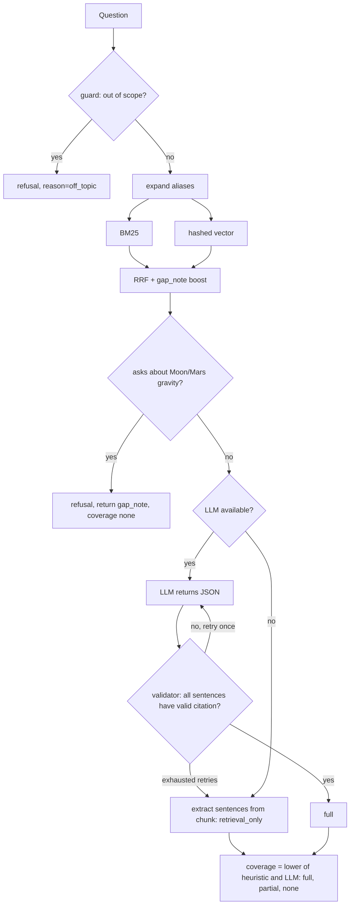

> **Educational prototype, excluded from the submitted application runtime.**
> The production extractive assistant lives in `../flameguard-ai-backend/app/integrations/rag/`.
> Optional Anthropic code and evaluation scores in this directory do not describe that assistant.
> Repository introduction: commit `d0563c4`, 2026-11-15 (+07:00); original authoring dates remain unverified.

# playbook-rag

Educational RAG running **offline** (no API key required): BM25 + optional vector + RRF, every answer accompanied by
verified citations, and knows how to report "no data available". The default knowledge base is the
`Flame_in_Freefall_Playbook.html` file itself. The design follows section 4 (RAG Design) of the playbook.

> This is a study and survey project. The repo **does not download and does not contain any NASA data**. If reused later for a hackathon
> submission, challenge rules apply (no work before 11/14/2026); please consult the official rules.

## Quick Start

```bash
python -m venv .venv && source .venv/bin/activate     # Windows: .venv\Scripts\activate
pip install -e ".[dev]"
python -m ragkit ingest          # build data/chunks.json (pre-built already)
python -m ragkit ask "Which experiment extinguished fire using CO2 or helium?"
python -m ragkit serve           # http://127.0.0.1:8000  (UI + POST /api/ask)
pytest -q && python -m ragkit eval
```

With `ANTHROPIC_API_KEY`, the pipeline uses an LLM to generate answers (`RAG_LLM_MODEL`, defaults to `claude-sonnet-5-5`),
then filters them with a validator. Without a key or if the LLM errors/times out after 15 seconds, it automatically falls back to **retrieval-only** (extracting sentences from chunks, citations retained). See `.env.example`.

The interface opens by default at **Q&A**, with 5 sample questions. Select a question and click **Find Answer**;
results always come from `/api/ask`. When the server errors, the interface displays the error and does not substitute simulated answers.
Click citation numbers to open the full source passage; internal documents are served via `/sources/{filename}`.

The **Experiments**, **Map**, and **Compare & Export** screens use an unverified demonstration catalog,
separating non-PSI milestones. CSV, JSON, Data Card, and notebook only serve the currently selected items, retaining demonstration labels.
Open the interface through the server (`web/index.html`) to test RAG alongside source documents.
The Playbook and “RAG Architecture with Jev.html” load Mermaid 11.16.1 from `web/assets/`; keep this directory
so diagrams work offline when opening HTML files or viewing the Playbook via `/sources/`.

## 3D Flame Observation Chamber

Open `/flame` on the same server, or click **3D Flame** from the research repository. Three.js renders
a volumetric flame using shaders: rotate/zoom, change color, morph elongated candle flame ↔ spherical dome,
adjust oscillation/brightness, pause, and save PNG. Libraries and fonts are bundled locally.
This is a visual illustration, not a CFD model or NASA experimental data.

After editing `web/src/`, rebuild the bundle (requires Node.js):

```powershell
cd web
npm ci --ignore-scripts
npm run build
```

The bundle is pre-built in `web/assets/`, so running the Python app does not require Node.js.
Details: [docs/FLAME-STUDIO.md](docs/FLAME-STUDIO.md).

## RAG Processing Pipeline



The `POST /api/ask` contract matches playbook section 4.4: `answer.segments[{text, citations}]`, `coverage`, `missing`,
`chunks`, `meta{mode, reason, latencyMs}`. System-generated segments (refusals, notes) include `system: true`.

Detailed design, data models, component diagrams, and differences from the playbook: [`docs/ARCHITECTURE.md`](docs/ARCHITECTURE.md).

## Structure

| Path | Role |
|---|---|
| `src/ragkit/ingest.py` | HTML/MD/TXT → chunks; extracts playbook JS arrays (glossary, source links, plans) |
| `text.py`, `bm25.py`, `vector.py`, `retrieve.py` | Vietnamese diacritic stripping + bigrams, BM25, character n-gram hashed embedding, RRF |
| `guard.py` | out of scope, safety verdict requests, data gap areas |
| `validate.py` | filters sentences lacking valid citations or containing "safe/unsafe" verdicts |
| `pipeline.py`, `llm.py`, `cache.py` | orchestration, Anthropic client (urllib), TTL cache, rate limit |
| `api.py`, `cli.py`, `web/index.html` | FastAPI, CLI, Q&A interface |
| `data/gap_notes.json`, `aliases.json`, `scenarios.json`, `eval_questions.json` | curated data, freely editable |

Ingest additional documents: drop `.md`, `.txt`, or `.html` into `data/corpus/` and run `python -m ragkit ingest`.

## Current Evaluation

`python -m ragkit eval` (24 questions: 19 retrieval, 5 refusal): Recall@5 = 1.0, MRR = 0.81, correct refusal = 1.0.
Thresholds per playbook: Recall@5 ≥ 0.85, correct refusal ≥ 0.90 (CI fails if lower).

Interpret these figures cautiously:

- Golden answers are taken directly from the playbook and the dataset contains only 24 questions, so it tests pipeline behavior rather than scientific fact.
- The playbook's "Sample Questions" table contains both questions and answers, so it was **excluded from indexing** (otherwise retrieval would match questions rather than content).
- After the first run, 1 question failed; adding common interrogative words ("bao", "lâu", "nhiều", "đâu") to stopwords brought it to 1.0. Given such a small benchmark, treat this as a slight risk of overfitting and add your own questions.

## Known Limitations

- **Real LLM not yet invoked.** The LLM path has only been tested with mock LLMs (valid, invalid citation, timeout). No API key/network has been used to test the real Anthropic API.
- The retrieval-only mode selects sentences based on word overlap; table chunks are flattened so column context may be lost (e.g., "II tests oxygen limits..." loses the word Saffire, even though the cited chunk contains it), and sometimes includes an extra less-relevant sentence.
- Default vector uses character n-gram hashing: captures spelling/stemming, **not** semantics. For true semantics: `pip install -e ".[st]"` and `RAG_EMBEDDER=st:<model>`.
- Guard, verdict detection, and coverage rely on regex rules / word overlap; unusual phrasing may slip through. Stripping diacritics also causes "lửa" (fire) and "lúa" (rice) to collide.
- Only static text and JS arrays for glossary/sources/plans are ingested. Mermaid diagrams and other JS widgets (ranking weights, Jev table, checklist) are not indexed.
- Covers RAG only. No Evidence Map, ranking engine, comparison view, or Jev.
