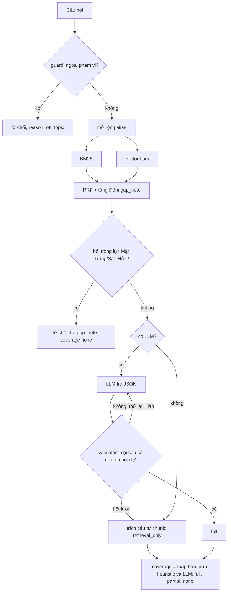

# playbook-rag

RAG học tập chạy **offline** (không cần API key): BM25 + vector tùy chọn + RRF, mỗi câu trả lời kèm trích dẫn
được kiểm chứng, và biết nói "chưa có dữ liệu". Kho tri thức mặc định là chính file
`Flame_in_Freefall_Playbook.html`. Thiết kế bám phần 4 (Thiết kế RAG) của playbook.

> Đây là dự án học và khảo sát. Repo **không tải và không chứa dữ liệu NASA nào**. Nếu sau này dùng lại cho bài dự thi
> hackathon thì áp dụng luật của đề (không làm trước 14/11/2026), hãy đối chiếu luật chính thức.

## Chạy nhanh

```bash
python -m venv .venv && source .venv/bin/activate     # Windows: .venv\Scripts\activate
pip install -e ".[dev]"
python -m ragkit ingest          # dựng data/chunks.json (đã dựng sẵn)
python -m ragkit ask "Thí nghiệm nào dập lửa bằng CO₂ hoặc heli?"
python -m ragkit serve           # http://127.0.0.1:8000  (giao diện + POST /api/ask)
pytest -q && python -m ragkit eval
```

Có `ANTHROPIC_API_KEY` thì pipeline dùng LLM soạn câu trả lời (`RAG_LLM_MODEL`, mặc định `claude-sonnet-5-5`),
rồi validator lọc lại. Không có khóa hoặc LLM lỗi/timeout 15 giây thì tự lùi về **retrieval-only** (trích câu từ chunk, vẫn có
trích dẫn). Xem `.env.example`.

Giao diện mở mặc định ở **Hỏi đáp**, có 5 câu hỏi mẫu. Chọn câu hỏi rồi bấm **Tìm câu trả lời**;
kết quả luôn đến từ `/api/ask`. Khi máy chủ lỗi, giao diện hiện lỗi và không thay bằng đáp án mô phỏng.
Nhấn số trích dẫn để mở toàn bộ đoạn nguồn; tài liệu nội bộ được phục vụ qua `/sources/{filename}`.

Các màn **Thí nghiệm**, **Bản đồ**, **So sánh & xuất** dùng danh mục minh họa chưa kiểm chứng,
tách các mốc ngoài PSI. CSV, JSON, Data Card và notebook chỉ phục vụ các mục đang chọn, giữ nhãn minh họa.
Mở giao diện qua server (`web/index.html`) để thử RAG cùng nguồn tài liệu.
Playbook và “Kiến trúc RAG với Jev.html” nạp Mermaid 11.16.1 từ `web/assets/`; giữ thư mục này
để sơ đồ chạy offline khi mở file HTML hoặc xem Playbook qua `/sources/`.

## Phòng quan sát lửa 3D

Mở `/flame` trên cùng server, hoặc nhấn **Lửa 3D** từ kho nghiên cứu. Three.js dựng
ngọn lửa thể tích bằng shader: xoay/zoom, đổi màu, biến hình lửa nến thuôn ↔ vòm cầu,
điều chỉnh dao động/độ sáng, tạm dừng và lưu PNG. Thư viện và font được đóng gói cục bộ.
Đây là minh họa hình ảnh, không phải mô hình CFD hay dữ liệu thực nghiệm NASA.

Sau khi sửa `web/src/`, dựng lại bundle (cần Node.js):

```powershell
cd web
npm ci --ignore-scripts
npm run build
```

Bundle đã có sẵn trong `web/assets/`, nên chạy app Python không cần Node.js.
Chi tiết: [docs/FLAME-STUDIO.md](docs/FLAME-STUDIO.md).

## Luồng xử lý RAG



Hợp đồng `POST /api/ask` giống playbook mục 4.4: `answer.segments[{text, citations}]`, `coverage`, `missing`,
`chunks`, `meta{mode, reason, latencyMs}`. Segment do hệ thống sinh (từ chối, ghi chú) có thêm `system: true`.

Chi tiết thiết kế, mô hình dữ liệu, sơ đồ thành phần và chỗ khác với playbook: [`docs/ARCHITECTURE.md`](docs/ARCHITECTURE.md).

## Cấu trúc

| Đường dẫn | Vai trò |
|---|---|
| `src/ragkit/ingest.py` | HTML/MD/TXT → chunk; lấy thêm mảng JS của playbook (thuật ngữ, link nguồn, kế hoạch) |
| `text.py`, `bm25.py`, `vector.py`, `retrieve.py` | bỏ dấu tiếng Việt + bigram, BM25, embedding băm n-gram, RRF |
| `guard.py` | ngoài phạm vi, đòi kết luận an toàn, vùng chưa có dữ liệu |
| `validate.py` | loại câu thiếu trích dẫn hợp lệ hoặc có phán quyết "an toàn/không an toàn" |
| `pipeline.py`, `llm.py`, `cache.py` | điều phối, client Anthropic (urllib), cache TTL, rate limit |
| `api.py`, `cli.py`, `web/index.html` | FastAPI, CLI, giao diện hỏi đáp |
| `data/gap_notes.json`, `aliases.json`, `scenarios.json`, `eval_questions.json` | dữ liệu viết tay, sửa tự do |

Nạp thêm tài liệu của bạn: bỏ `.md`, `.txt` hoặc `.html` vào `data/corpus/` rồi chạy `python -m ragkit ingest`.

## Đánh giá hiện tại

`python -m ragkit eval` (24 câu: 19 truy xuất, 5 từ chối): Recall@5 = 1.0, MRR = 0.81, từ chối đúng = 1.0.
Ngưỡng theo playbook: Recall@5 ≥ 0.85, từ chối đúng ≥ 0.90 (CI fail nếu thấp hơn).

Đọc con số này thận trọng:

- Đáp án vàng lấy từ chính playbook và bộ chỉ có 24 câu, nên nó kiểm tra pipeline chứ không kiểm tra sự thật khoa học.
- Bảng "Bộ câu hỏi mẫu" của playbook chứa cả câu hỏi lẫn đáp án nên đã bị **loại khỏi chỉ mục** (nếu để lại, truy xuất sẽ trúng câu hỏi chứ không phải nội dung).
- Sau lần chạy đầu có 1 câu fail; tôi thêm các từ nghi vấn chung ("bao", "lâu", "nhiều", "đâu") vào stopword rồi mới đạt 1.0. Với bộ nhỏ như vậy, hãy coi đó là nguy cơ overfit nhẹ và thêm câu hỏi của riêng bạn.

## Giới hạn đã biết

- **Chưa gọi LLM thật.** Đường LLM chỉ được test bằng LLM giả (hợp lệ, trích dẫn sai, timeout). Chưa có khóa/mạng để thử Anthropic API thật.
- Chế độ retrieval-only chọn câu theo độ trùng từ; chunk từ bảng bị làm phẳng nên có thể mất ngữ cảnh cột (câu "II kiểm giới hạn oxy…" mất chữ Saffire, dù chunk được trích vẫn có), và đôi khi chọn thêm một câu ít liên quan.
- Vector mặc định là băm n-gram ký tự: bắt chính tả/từ gốc, **không** phải ngữ nghĩa. Muốn ngữ nghĩa thật: `pip install -e ".[st]"` và `RAG_EMBEDDER=st:<model>`.
- Guard, bộ phát hiện phán quyết và coverage là quy tắc regex/độ trùng từ; cách diễn đạt lạ có thể lọt. Bỏ dấu cũng làm "lửa" và "lúa" trùng nhau.
- Mới ingest phần văn bản tĩnh, mảng JS thuật ngữ/nguồn/kế hoạch. Biểu đồ Mermaid và các widget JS khác (trọng số xếp hạng, bảng Jev, checklist) chưa được lập chỉ mục.
- Chỉ làm phần RAG. Không có Evidence Map, engine xếp hạng, màn so sánh hay Jev.
