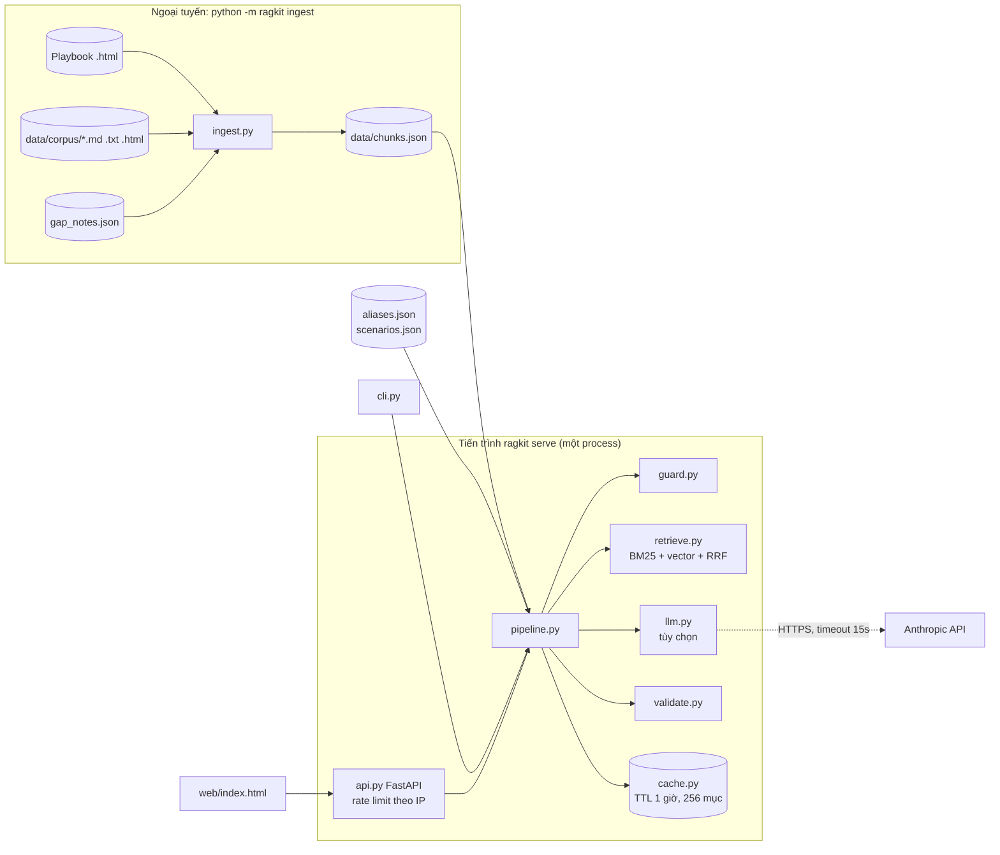
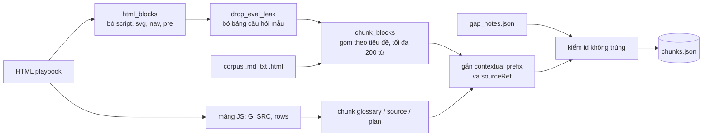
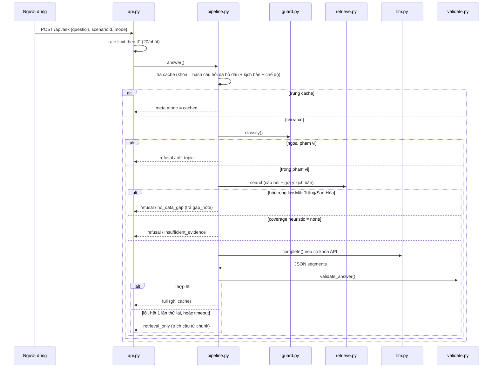

# Kiến trúc playbook-rag

Tài liệu này mô tả đúng những gì có trong code ở thời điểm này. Chỗ nào repo khác thiết kế gốc của playbook (mục 4) thì có bảng riêng ở cuối.

## 1. Nguyên tắc thiết kế

1. **Không bịa.** Mọi câu trả lời phải trỏ về chunk có thật. Câu không có trích dẫn hợp lệ bị loại bởi code, không dựa vào việc LLM tự giác.
2. **Biết từ chối.** Ngoài phạm vi, vùng chưa có dữ liệu và yêu cầu phán quyết an toàn được xử lý bằng quy tắc xác định, không phó mặc cho LLM.
3. **Chạy được khi LLM hỏng.** Toàn bộ đường truy xuất và từ chối không cần mạng. LLM chỉ là lớp soạn văn tùy chọn.
4. **Kho nhỏ, đơn giản.** Vài trăm chunk nên không cần vector DB: chỉ mục dựng trong bộ nhớ lúc khởi động.

## 2. Thành phần

Chỉ mục (BM25, vector) **không lưu ra đĩa**: `pipeline.py` dựng lại từ `chunks.json` mỗi lần khởi động, đo được khoảng 0,15 giây với 138 chunk trong lần đo ban đầu.

## 3. Pipeline ingest (ngoại tuyến)

Điểm đáng chú ý:

- **Gom chunk:** các block cùng (section, h2, h3) được gom lại tới tối đa 200 từ. Block quá dài thì tách theo câu. Mẩu cuối dưới 40 từ thì nhập vào mẩu trước. Mẩu dưới 6 từ (nhãn lẻ) bị bỏ.
- **Bảng:** mỗi ô cách nhau bằng ` | `, mỗi dòng là một block. Chunk từ bảng vì vậy bị "làm phẳng", mất tên cột.
- **Contextual prefix:** `"Tên tài liệu > h2 > h3"`, sinh bằng quy tắc, không dùng LLM. Nó được ghép vào văn bản khi lập chỉ mục nhưng không hiện ra khi trả lời.
- **Dữ liệu trong JS:** thuật ngữ (`G`), link nguồn (`SRC`) và kế hoạch (`rows`) được parse từ thẻ `<script>` bằng regex rồi `json.loads`. Nếu playbook đổi cách khai báo biến JS thì phần này im lặng trả về rỗng; `tests/test_ingest.py` kiểm số lượng từng loại chunk để bắt lỗi đó.
- **Loại rò rỉ đánh giá:** bảng "Bộ câu hỏi mẫu" bị bỏ khỏi chỉ mục để Recall@5 không đẹp giả.

## 4. Mô hình dữ liệu chunk

Mỗi chunk là một dict trong `chunks.json`:

| Trường | Ý nghĩa |
|---|---|
| `id` | duy nhất, ví dụ `kien-truc-09`, `gl-rrf`, `src-17`, `plan-03`, `gap-moon-mars-gravity`, `corpus-...` |
| `type` | `passage`, `glossary`, `source`, `plan`, `gap_note` |
| `section`, `heading` | vị trí trong tài liệu gốc (id section, tiêu đề h3 hoặc h2) |
| `text` | nội dung hiển thị và dùng để trích dẫn |
| `contextual` | tiền tố ngữ cảnh, chỉ dùng khi lập chỉ mục |
| `sourceRef` | `{title, url}`; với `source` là link ngoài, còn lại trỏ `Flame_in_Freefall_Playbook.html#<section>` |
| `status` | `source-text` (từ văn bản playbook) hoặc nhãn của playbook cho link: `link-confirmed`, `needs-check`, `unconfirmed` |
| `storage` | chỉ có ở `source`: nhãn lưu trữ của playbook (`pub`, `meta`, `web`) |
| `applies` | chỉ có ở `gap_note`: `moon_mars_gravity`, `safety_verdict`, `moon_base_conditions` |

Sau khi gộp danh mục nguồn vào Playbook gốc ngày 02/11/2026, có 162 chunk: 58 passage, 34 glossary, 55 source, 12 plan, 3 gap_note.

`status` ở đây khác với `verified/unverified/placeholder` trong playbook: repo này không có bước người kiểm chứng số liệu, nên chỉ ghi lại nhãn mà chính playbook đã gắn.

## 5. Luồng một câu hỏi

### 5.1 Guard (`guard.py`)

Chạy trên văn bản đã bỏ dấu, theo thứ tự:

1. **Ngoài phạm vi** nếu khớp danh sách chặn (tên lửa, thời tiết, cổ phiếu, bóng đá, nấu ăn) hoặc không chứa thuật ngữ miền nào (danh sách `DOMAIN` cộng tên các mục glossary).
2. **Verdict** nếu có cụm như "có an toàn", "thì an toàn", "không an toàn". Cụm "an toàn cháy" (tên trụ cột) cố ý không bị tính.
3. **Gap** nếu nhắc Mặt Trăng/Sao Hỏa/LUCI/FM2 **và** từ về trọng lực/dữ liệu/thí nghiệm. Hỏi về điều kiện của căn cứ Mặt Trăng (oxy, áp suất) không bị coi là gap.

Verdict và gap độc lập nhau: câu "Vật liệu qua bài thử 1g thì an toàn trên Mặt Trăng" kích hoạt cả hai.

### 5.2 Truy xuất (`retrieve.py`)

| Bước | Chi tiết |
|---|---|
| Mở rộng | nếu câu hỏi chứa khóa trong `aliases.json` (so sánh sau khi bỏ dấu, theo ranh giới từ) thì nối thêm các cụm tương ứng |
| BM25 | k1 = 1.5, b = 0.75, lấy top 20. Token = từ đã bỏ dấu, từ có gạch nối giữ cả dạng đầy đủ lẫn từng phần, thêm bigram liền kề |
| Vector | băm n-gram ký tự 3 đến 5 vào 1024 chiều, có dấu, trọng số log, chuẩn hóa L2, độ đo cosine, lấy top 20 |
| RRF | điểm = Σ 1/(60 + hạng) trên hai danh sách |
| Tăng điểm | nhân 1.5 cho chunk `gap_note` khi câu hỏi thuộc loại gap hoặc verdict |
| Kết quả | top 6 (`RAG_TOP_K`) |

Chỉ mục vector đổi được sang sentence-transformers bằng `RAG_EMBEDDER=st:<model>`, hoặc tắt hẳn bằng cách đặt rỗng (khi đó chỉ còn BM25).

### 5.3 Sinh câu trả lời

- **Có LLM:** prompt hệ thống ép dùng đúng chunk được cấp, mỗi câu kèm id, không kết luận an toàn, trả JSON. Tối đa 2 lần gọi (1 lần thử lại), tổng thời gian không vượt `RAG_TIMEOUT_S` (15 giây). Mọi ngoại lệ (mạng, HTTP, timeout) đều dẫn tới retrieval-only.
- **Validator** (`validate.py`): giữ segment nào có ít nhất một citation nằm trong tập chunk đã cấp, loại segment không có citation, citation lạ, hoặc chứa phán quyết như "là an toàn" / "không an toàn". Câu nói rõ "không kết luận" (ví dụ chính quy tắc của playbook) được miễn. Không segment nào sống sót thì coi như thất bại.
- **Không có LLM (retrieval-only):** với 3 chunk đầu, chọn câu có nhiều từ trùng câu hỏi nhất (cắt ở 320 ký tự), mỗi câu trích dẫn chunk của nó.
- **Coverage:** `heuristic` = tỷ lệ từ khóa của câu hỏi xuất hiện trong 3 chunk đầu (≥ 0.7 là full, ≥ 0.4 là partial, còn lại none). Với LLM thì lấy mức thấp hơn giữa heuristic và giá trị LLM tự khai. Câu verdict bị chặn ở tối đa partial. Heuristic ra none thì từ chối với lý do `insufficient_evidence`.

### 5.4 Chế độ và lý do trả về

`meta.mode`: `full`, `retrieval_only`, `cached`, `refusal`.
`meta.reason`: `off_topic`, `no_data_gap`, `safety_verdict`, `insufficient_evidence`, hoặc `null`.

Chỉ kết quả `full` được cache. Câu từ chối và retrieval-only tính lại mỗi lần vì rẻ.

## 6. Vận hành

| Mục | Hiện trạng |
|---|---|
| Cấu hình | biến môi trường (xem `.env.example`, `config.py`) |
| Rate limit | cửa sổ trượt 20 yêu cầu/phút/IP, **lưu trong bộ nhớ**, không chia sẻ giữa nhiều process |
| Cache | TTL 1 giờ, tối đa 256 mục, cũng trong bộ nhớ |
| Triển khai | một process `uvicorn`. Chưa có Dockerfile, Procfile hay cấu hình cloud |
| Bảo mật | khóa API chỉ đọc từ biến môi trường ở server. Giao diện dựng DOM bằng `textContent`, không chèn HTML thô. Chưa có xác thực người dùng |
| Quan sát | chưa có log có cấu trúc hay metric. Chỉ có `meta.latencyMs` trong mỗi phản hồi |

## 7. Kiểm thử và đánh giá

- `pytest`: 23 test (chuẩn hóa, BM25, ingest, guard, validator, pipeline với LLM giả, API, ngưỡng đánh giá).
- `python -m ragkit eval`: Recall@5, MRR trên 19 câu truy xuất và độ chính xác từ chối trên 5 câu. Kết quả ghi vào `reports/eval.json`. CI fail nếu Recall@5 < 0.85 hoặc từ chối đúng < 0.90.

## 8. Khác với thiết kế gốc của playbook

| Chủ đề | Playbook | Repo này | Lý do |
|---|---|---|---|
| Ngôn ngữ, framework | Next.js, TypeScript, Vercel | Python, FastAPI | học và chạy local dễ hơn, không cần Node |
| Lưu dữ liệu | JSON tĩnh kiểm bằng Zod | JSON tĩnh, kiểm id không trùng, chưa có schema validation đầy đủ | giữ gọn |
| Tìm từ khóa | MiniSearch | BM25 tự viết | không phụ thuộc thư viện |
| Vector | tùy chọn, embedding thật | băm n-gram (mặc định), sentence-transformers (tùy chọn) | chạy offline được |
| Rerank | tùy chọn (Jev hoặc LLM) | **chưa có** | playbook cũng để tùy chọn |
| Jev | tùy chọn | **không dùng** | đang early access |
| Tiền tố ngữ cảnh | LLM sinh một lần lúc build | sinh bằng quy tắc | không cần LLM |
| Phát hiện ý định, từ chối | LLM hoặc Jev | regex xác định | rẻ, tái lập được, nhưng cứng hơn |
| Trạng thái dữ liệu | verified / unverified / placeholder | nhãn link của playbook | repo không có bước người kiểm chứng |
| Phần ngoài RAG | Mission Brief, Evidence Map, Compare, xuất dữ liệu | **không có** | chỉ làm phần RAG |
| Dữ liệu | thí nghiệm PSI đã tuyển chọn | chỉ nội dung playbook | không tải dữ liệu NASA |

## 9. Hạn chế và rủi ro thiết kế

- **Dữ liệu chỉ đọc một lần:** `chunks.json` được đọc một lần lúc khởi động. Sửa dữ liệu thì phải chạy lại `ingest` và khởi động lại server.
- **Quy tắc guard dễ bị lách và dễ chặn nhầm.** Ví dụ bỏ dấu làm "lửa" và "lúa" trùng nhau, nên guard phải bắt riêng "tên lửa". Câu hỏi diễn đạt lạ có thể lọt hoặc bị từ chối oan.
- **Validator chỉ kiểm sự tồn tại của citation**, không kiểm chunk đó có thật sự ủng hộ câu hay không. Đó là việc của đánh giá thủ công (playbook đặt mục tiêu ≥ 0.95 và chưa có công cụ đo trong repo).
- **Coverage là độ trùng từ**, không phải độ đủ bằng chứng theo nghĩa. Câu hỏi nhiều từ chung chung có thể ra "full" dù chunk chưa trả lời đúng ý.
- **Retrieval-only có thể kéo thêm câu ít liên quan** (ví dụ định nghĩa PSI khi hỏi về oxy).
- **Đường LLM chưa được thử với API thật.**

## 10. Điểm mở rộng

| Muốn làm | Sửa ở đâu |
|---|---|
| Nạp tài liệu mới | thả file vào `data/corpus/` rồi `ingest` |
| Thêm vùng "chưa có dữ liệu" | thêm mục vào `gap_notes.json`, thêm nhánh nhận diện trong `guard.py` và `pipeline.py` |
| Thêm viết tắt, từ đồng nghĩa | `aliases.json` |
| Thêm kịch bản | `scenarios.json` (trường `hint` được nối vào truy vấn) |
| Thêm câu hỏi đánh giá | `eval_questions.json` (`kind` là `retrieval` hoặc `refuse`) |
| Đổi nhà cung cấp LLM | viết lớp có hàm `complete(system, user, timeout) -> str` như `AnthropicLLM` |
| Thêm reranker | chèn bước giữa `Retriever.search` và `_try_llm` trong `pipeline.py` |
| Đổi embedding | `RAG_EMBEDDER=st:<model>` hoặc thêm lớp trong `vector.py` |
