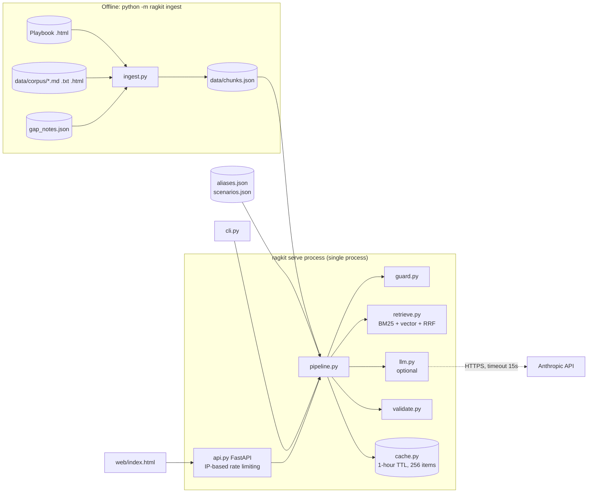
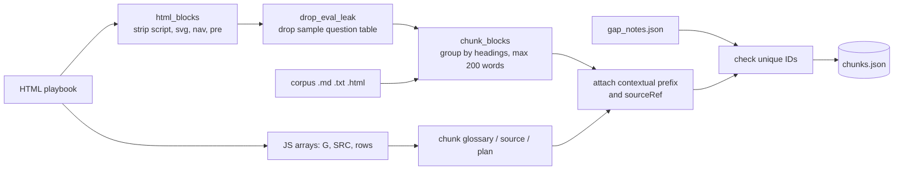
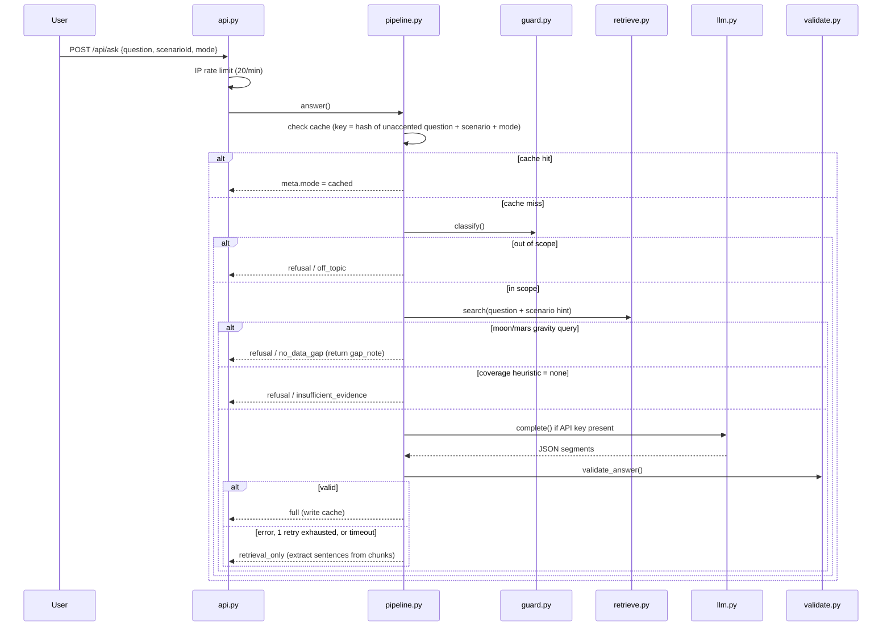

# playbook-rag Architecture

This document accurately describes what is currently implemented in the code. Where this repository differs from the original playbook design (section 4), a dedicated comparison table is provided at the end.

## 1. Design Principles

1. **No hallucinations.** Every answer must point to an actual chunk. Sentences without valid citations are eliminated by code, without relying on LLM compliance.
2. **Know when to refuse.** Out-of-scope queries, data gap regions, and requests for safety verdicts are handled by deterministic rules, rather than left to the LLM.
3. **Operable when LLM fails.** The entire retrieval and refusal pipeline requires no network access. The LLM is merely an optional drafting layer.
4. **Small, simple store.** A few hundred chunks mean no vector DB is needed: indices are built in-memory at startup.

## 2. Components

Indices (BM25, vector) are **not saved to disk**: `pipeline.py` rebuilds them from `chunks.json` on each startup, taking approximately 0.15 seconds for 138 chunks in initial benchmarks.

## 3. Ingest Pipeline (Offline)

Notable points:

- **Chunk grouping:** Blocks sharing the same (section, h2, h3) are grouped up to a maximum of 200 words. Blocks that are too long are split by sentence. Trailing fragments under 40 words are merged into the preceding fragment. Fragments under 6 words (stray labels) are dropped.
- **Tables:** Cells are separated by ` | `, with each row being a block. Chunks from tables are therefore "flattened", losing column headers.
- **Contextual prefix:** `"Document Title > h2 > h3"`, rule-generated, without using an LLM. It is prepended to text during indexing but does not appear in final answers.
- **Data in JS:** Glossaries (`G`), source links (`SRC`), and plans (`rows`) are parsed from `<script>` tags using regex and `json.loads`. If the playbook changes how JS variables are declared, this section silently returns empty; `tests/test_ingest.py` checks chunk counts per type to catch such issues.
- **Evaluation leak prevention:** The "Sample Questions" table is excluded from indexing to prevent artificially inflated Recall@5.

## 4. Chunk Data Model

Each chunk is a dict in `chunks.json`:

| Field | Description |
|---|---|
| `id` | unique, e.g. `kien-truc-09`, `gl-rrf`, `src-17`, `plan-03`, `gap-moon-mars-gravity`, `corpus-...` |
| `type` | `passage`, `glossary`, `source`, `plan`, `gap_note` |
| `section`, `heading` | location in source document (section id, h3 or h2 heading) |
| `text` | content displayed and used for citations |
| `contextual` | contextual prefix, only used during indexing |
| `sourceRef` | `{title, url}`; external link for `source`, otherwise points to `Flame_in_Freefall_Playbook.html#<section>` |
| `status` | `source-text` (from playbook text) or playbook link label: `link-confirmed`, `needs-check`, `unconfirmed` |
| `storage` | only in `source`: playbook storage label (`pub`, `meta`, `web`) |
| `applies` | only in `gap_note`: `moon_mars_gravity`, `safety_verdict`, `moon_base_conditions` |

Following the merge of source catalogs into the original Playbook on 2026-11-02, there are 162 chunks: 58 passage, 34 glossary, 55 source, 12 plan, 3 gap_note.

`status` here differs from `verified/unverified/placeholder` in the playbook: this repository does not include a human data verification step, so it merely records the labels assigned by the playbook itself.

## 5. Query Flow

### 5.1 Guard (`guard.py`)

Operates on unaccented text, in the following order:

1. **Out of scope** if matching the blocklist (rockets, weather, stocks, football, cooking) or lacking any domain terminology (`DOMAIN` list plus glossary entry names).
2. **Verdict** if containing phrases like "is safe", "then safe", "not safe" (matching unaccented patterns like `co an toan`, `thi an toan`, `khong an toan`). The phrase "fire safety" (`an toan chay`, a pillar name) is deliberately excluded.
3. **Gap** if mentioning Moon/Mars/LUCI/FM2 **and** terms related to gravity/data/experiments. Asking about lunar base conditions (oxygen, pressure) is not considered a gap.

Verdict and gap are independent: a query like "Materials tested at 1g are safe on the Moon" triggers both.

### 5.2 Retrieval (`retrieve.py`)

| Step | Details |
|---|---|
| Expansion | If the query contains keys in `aliases.json` (matched after folding diacritics, on word boundaries), append the corresponding phrases |
| BM25 | k1 = 1.5, b = 0.75, retrieve top 20. Token = unaccented words, hyphenated words kept both in full and split forms, plus adjacent bigrams |
| Vector | Hashes character n-grams (3 to 5) into 1024 dimensions with diacritics, log weighting, L2 normalized, cosine similarity, retrieve top 20 |
| RRF | Score = Σ 1/(60 + rank) across the two lists |
| Boost | Multiply by 1.5 for `gap_note` chunks when the query is classified as gap or verdict |
| Result | Top 6 (`RAG_TOP_K`) |

The vector index can be switched to sentence-transformers via `RAG_EMBEDDER=st:<model>`, or disabled entirely by setting it empty (falling back to BM25 only).

### 5.3 Answer Generation

- **With LLM:** The system prompt enforces using only the provided chunks, citing an id for each sentence, making no safety conclusions, and returning JSON. At most 2 calls (1 retry), total duration not exceeding `RAG_TIMEOUT_S` (15 seconds). Any exception (network, HTTP, timeout) falls back to retrieval-only.
- **Validator** (`validate.py`): Keeps segments that have at least one citation within the provided chunk set; eliminates segments lacking citations, containing unknown citations, or containing verdicts like "is safe" / "unsafe". Sentences explicitly stating "no conclusion" (e.g. the playbook's own rule) are exempt. If no segments survive, it is considered a failure.
- **Without LLM (retrieval-only):** From the top 3 chunks, selects the sentence with the highest word overlap with the query (truncated at 320 characters), with each sentence citing its chunk.
- **Coverage:** `heuristic` = ratio of query keywords appearing in the top 3 chunks (≥ 0.7 is full, ≥ 0.4 is partial, otherwise none). With LLM, takes the lower of the heuristic and the self-reported LLM value. Verdict queries are capped at partial. If the heuristic yields none, the query is refused with reason `insufficient_evidence`.

### 5.4 Return Modes and Reasons

`meta.mode`: `full`, `retrieval_only`, `cached`, `refusal`.
`meta.reason`: `off_topic`, `no_data_gap`, `safety_verdict`, `insufficient_evidence`, or `null`.

Only `full` results are cached. Refusals and retrieval-only responses are recomputed each time because they are inexpensive.

## 6. Operations

| Item | Current Status |
|---|---|
| Configuration | Environment variables (see `.env.example`, `config.py`) |
| Rate limit | Sliding window of 20 requests/minute/IP, **in-memory**, not shared across processes |
| Cache | 1-hour TTL, up to 256 entries, also in-memory |
| Deployment | Single `uvicorn` process. No Dockerfile, Procfile, or cloud configuration yet |
| Security | API keys read only from server environment variables. UI constructs DOM using `textContent`, without inserting raw HTML. No user authentication yet |
| Observability | No structured logs or metrics yet. Only `meta.latencyMs` in each response |

## 7. Testing and Evaluation

- `pytest`: 23 tests (normalization, BM25, ingest, guard, validator, pipeline with mock LLM, API, evaluation thresholds).
- `python -m ragkit eval`: Recall@5, MRR across 19 retrieval queries, and refusal accuracy across 5 queries. Results written to `reports/eval.json`. CI fails if Recall@5 < 0.85 or correct refusal < 0.90.

## 8. Differences from Original Playbook Design

| Topic | Playbook | This Repo | Reason |
|---|---|---|---|
| Language, framework | Next.js, TypeScript, Vercel | Python, FastAPI | Easier to learn and run locally, no Node required |
| Data storage | Static JSON validated with Zod | Static JSON, unique ID checks, full schema validation not yet implemented | Keep it lightweight |
| Keyword search | MiniSearch | Custom BM25 | No library dependency |
| Vector | Optional, real embeddings | Character n-gram hashing (default), sentence-transformers (optional) | Can run offline |
| Rerank | Optional (Jev or LLM) | **Not yet implemented** | Playbook also keeps it optional |
| Jev | Optional | **Not used** | Currently in early access |
| Contextual prefix | LLM-generated once at build time | Rule-generated | No LLM needed |
| Intent detection, refusal | LLM or Jev | Deterministic regex | Inexpensive, reproducible, but more rigid |
| Data status | verified / unverified / placeholder | Playbook link labels | Repo lacks a human verification step |
| Non-RAG components | Mission Brief, Evidence Map, Compare, data export | **None** | Focuses solely on RAG |
| Data | Curated PSI experiments | Playbook content only | Does not download NASA data |

## 9. Design Limitations and Risks

- **Data read only once:** `chunks.json` is read once at startup. Modifying data requires re-running `ingest` and restarting the server.
- **Guard rules are easily bypassed and prone to false positives.** For example, stripping diacritics collapses words for fire and rice into the same string ("lua"), so the guard must explicitly handle "rocket" ("ten lua"). Unusually phrased queries may slip through or be falsely rejected.
- **Validator only checks citation existence**, not whether that chunk actually supports the statement. That requires manual evaluation (the playbook targets ≥ 0.95, and no measurement tool exists in this repo yet).
- **Coverage is based on word overlap**, not semantic evidence sufficiency. Queries with many generic words may yield "full" even if chunks do not directly address the point.
- **Retrieval-only may pull in less relevant sentences** (e.g. PSI definitions when asking about oxygen).
- **LLM path has not been tested with the live API.**

## 10. Extension Points

| Goal | Where to Edit |
|---|---|
| Ingest new documents | Drop files into `data/corpus/` and run `ingest` |
| Add a "no data" gap region | Add entry to `gap_notes.json`, add detection branch in `guard.py` and `pipeline.py` |
| Add abbreviations, synonyms | `aliases.json` |
| Add scenarios | `scenarios.json` (`hint` field is appended to query) |
| Add evaluation questions | `eval_questions.json` (`kind` is `retrieval` or `refuse`) |
| Switch LLM provider | Implement a class with `complete(system, user, timeout) -> str` like `AnthropicLLM` |
| Add reranker | Insert a step between `Retriever.search` and `_try_llm` in `pipeline.py` |
| Change embedding | `RAG_EMBEDDER=st:<model>` or add a class in `vector.py` |
